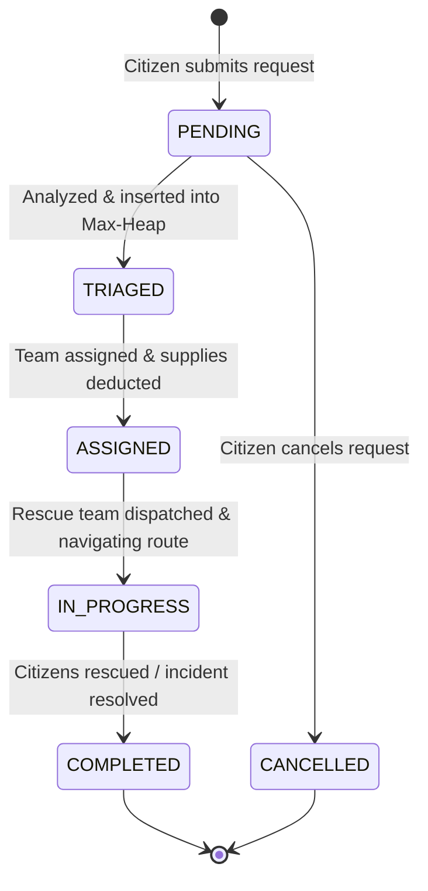
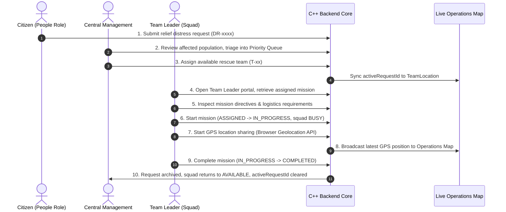

# Real-Time Disaster Relief Request Management System (RT-DRMS)

A modular, college-level Data Structures course project demonstrating core manual data structure implementations in **C++** coupled with an intuitive, responsive **HTML/CSS/Vanilla JavaScript** frontend.

---

## 1. Project Overview & Objectives

In large-scale emergencies (floods, earthquakes, fires, structural collapses), communication channels often become overwhelmed, resulting in chaotic resource distribution and delayed emergency response.

The **Real-Time Disaster Relief Request Management System (RT-DRMS)** solves this by providing:
1. **Citizen Portal (People View):** Quick submission of rescue/relief requests and real-time status tracking using tracking IDs without login barriers.
2. **Operations Dashboard (Management View):** Dynamic triage of incoming distress calls by severity, dispatching available rescue teams, tracking relief supplies, and calculating the fastest rescue route using graph algorithms.
3. **Team Leader Portal (Phase 2):** Dedicated, squad-isolated field terminal allowing rescue teams to review detailed mission requirements (population, rations, medical kits, coordinates, route directions), start operations (`IN_PROGRESS`), and report field completions (`COMPLETED`) with backend ownership validation.

### Academic Objectives (Data Structures Syllabus Compliance)
Unlike commercial frameworks that rely on black-box libraries, this project implements foundational data structures **from scratch in C++**:
- **Structures & Classes:** Clean object modeling for domain entities.
- **Arrays & Singly Linked Lists:** Linear sequence tracking and dynamic record logs.
- **FIFO Queue:** Sequential first-come-first-served standard processing.
- **Binary Heap Priority Queue:** $O(\log N)$ severity triage for emergency distress calls.
- **Stack (LIFO):** Operational dispatch rollback and action undo history.
- **Hash Table with Chaining:** Instant $O(1)$ average-time request tracking by ID.
- **Graph (Adjacency List):** City zone network and disaster connectivity modeling.
- **Dijkstra's Algorithm:** Shortest-path calculation for emergency dispatch navigation.
- **Sorting & Searching:** MergeSort/QuickSort for reporting, and Binary Search for indexed queries.
- **File Handling:** Persistent CSV/flat-file storage ensuring zero data loss across restarts.

---

## 2. Modular Architecture & Directory Structure

```
FDS CP/
├── backend/                        # C++ Backend Core
│   ├── include/                    # Header files (.h)
│   │   ├── models/                 # Domain entity definitions
│   │   │   ├── Enums.h             # Severity, status, and role enums
│   │   │   ├── ReliefRequest.h     # Distress request record
│   │   │   ├── RescueTeam.h        # Emergency response unit
│   │   │   ├── Resource.h          # Inventory items (Food, Water, Kits)
│   │   │   ├── ReliefCenter.h      # Base camp / hub locations
│   │   │   └── TeamLocation.h      # Live GPS squad telemetry model
│   │   ├── datastructures/         # Manual Data Structure Declarations
│   │   │   ├── LinkedList.h        # Singly linked list (dynamic record logging)
│   │   │   ├── Queue.h             # FIFO Queue (routine dispatch pipeline)
│   │   │   ├── PriorityQueue.h     # Binary Max-Heap (triage prioritization)
│   │   │   ├── Stack.h             # LIFO Stack (undo & audit rollback)
│   │   │   ├── HashTable.h         # Hash table with chaining (O(1) search)
│   │   │   └── Graph.h             # Adjacency list & Dijkstra's algorithm
│   │   ├── services/               # Application Business Logic Services
│   │   │   ├── FileService.h       # Flat-file persistence & validation routines
│   │   │   ├── ManagementService.h # Triage, dispatch, and resource management
│   │   │   ├── PeopleService.h     # Citizen request handling and tracking
│   │   │   └── ServerService.h     # Persistent IPC JSON bridge server
│   │   └── utils/                  # Helper utilities
│   │       └── Algorithms.h        # Linear/Binary search & Bubble/Selection/Insertion sort
│   ├── src/                        # C++ Implementation files (.cpp)
│   │   ├── datastructures/         # DSA Implementation Source Files
│   │   │   ├── LinkedList.cpp      # Singly linked list implementation
│   │   │   ├── Queue.cpp           # FIFO Queue implementation
│   │   │   ├── PriorityQueue.cpp   # Binary Max-Heap implementation
│   │   │   ├── Stack.cpp           # LIFO Stack implementation
│   │   │   ├── HashTable.cpp       # Hash table with separate chaining
│   │   │   └── Graph.cpp           # Graph & Dijkstra's algorithm implementation
│   │   ├── utils/                  # Utility Implementation Source Files
│   │   │   └── Algorithms.cpp      # Searching and sorting implementations
│   │   └── main.cpp                # CLI entry point, test suites, and bridge server driver
│   ├── data/                       # Local persistent flat-file storage (.txt)
│   │   ├── requests.txt            # Disaster requests data store
│   │   ├── teams.txt               # Rescue teams data store
│   │   ├── resources.txt           # Relief supplies inventory
│   │   ├── centers.txt             # Relief centers and hubs
│   │   ├── team_locations.txt      # Team GPS coordinates & telemetry
│   │   └── team_users.txt          # Team leader credentials (salted SHA-256 hashes)
│   └── build.bat                   # Compilation script for g++ (MinGW C++11)
│
├── frontend/                       # Web Presentation Layer (Vanilla HTML5/CSS3/JS)
│   ├── index.html                  # Single-page interface (Citizen, Management, Squad Leader)
│   ├── css/
│   │   ├── style.css               # Base theme, typography, layout
│   │   ├── dashboard.css           # Management controls, tables, cards
│   │   ├── leaflet.css             # Leaflet mapping styles
│   │   └── responsive.css          # Mobile and desktop responsive layouts
│   └── js/
│       ├── api.js                  # Frontend REST API client
│       ├── app.js                  # Application initialization and routing
│       ├── graph.js                # Graph topological node visualizer
│       ├── leaflet.js              # Leaflet mapping library
│       ├── management.js           # Management portal controllers
│       ├── map.js                  # Interactive live operations map
│       ├── people.js               # Citizen submission & tracking controllers
│       ├── requests.js             # Request formatting and helpers
│       ├── resources.js            # Resource inventory utilities
│       ├── storage.js              # Local caching utilities
│       ├── teams.js                # Team status utilities
│       └── team_leader.js          # Field squad leader mission controllers
│
├── scratch/                        # Automated Verification Test Suites
│   ├── test_integration.js         # Comprehensive 173-assertion integration test suite
│   └── verify_security.js          # Cybersecurity & access control verification
│
├── server.js                       # Lightweight Node.js local preview & IPC API bridge
├── RUNNING.md                      # Windows setup, compilation, and execution guide
└── README.md                       # Comprehensive project documentation & evaluation guide
```

---

## 3. Module Responsibilities

| Module / Layer | Primary Responsibility |
| :--- | :--- |
| **`models/`** | Defines plain data structures and classes (`ReliefRequest`, `RescueTeam`, `Resource`, `ReliefCenter`, `TeamLocation`, `Enums`). Holds attributes, constructors, and serialization routines. No business logic. |
| **`datastructures/`** | Contains generic, manual data structures implemented using raw pointers and arrays (`LinkedList`, `Queue`, `PriorityQueue`, `Stack`, `HashTable`, `Graph`). Adheres strictly to core memory safety and custom algorithms without relying on STL containers (`std::vector`, `std::map`, etc.). |
| **`services/`** | Coordinates data structures to fulfill business use-cases (`ManagementService`, `PeopleService`, `FileService`, `ServerService`). Routes urgent tickets to the Max-Heap, maintains LIFO undo stack, and exposes stdio IPC. |
| **`utils/Algorithms`** | Custom C++11 searching (Linear search, Binary search on sorted arrays) and sorting algorithms (Bubble Sort by ID, Selection Sort by people, Insertion Sort by severity, Bubble Sort by timestamp). |
| **`backend/src/main.cpp`** | Provides an independent CLI driver to verify all data structures and services independently from the browser, or runs persistent JSON bridge server (`--server`). |
| **`frontend/`** | Provides a responsive, accessible user experience across Citizen, Management, and Squad Leader portals using vanilla HTML5, CSS3, and JavaScript (ES6). Decoupled via `api.js`. |

---

## 4. Core Data Models

### 4.1. ReliefRequest
Represents an individual distress call filed by a citizen.
- `id` (`std::string`): Unique request code (e.g., `"DR-1001"`).
- `citizenName` (`std::string`): Contact person name.
- `contactPhone` (`std::string`): 10-digit mobile number.
- `location` (`std::string`): Disaster location / area zone node (e.g., `"Area B"` or `"North Area"`).
- `disasterType` (`std::string`): `"Flood"`, `"Earthquake"`, `"Fire"`, `"Building Collapse"`, `"Cyclone"`.
- `requestType` (`std::string`): `"Medical"`, `"Rescue"`, `"Food"`, `"Water"`, `"Shelter"`.
- `peopleCount` (`int`): Count of trapped or affected individuals.
- `severity` (`SeverityLevel`): Enum: `CRITICAL (3)`, `HIGH (2)`, `NORMAL (1)`, `LOW (0)`.
- `details` (`std::string`): Specific remarks (e.g., `"Trapped on 2nd floor, diabetic"`).
- `status` (`RequestStatus`): Enum: `PENDING`, `TRIAGED`, `ASSIGNED`, `IN_PROGRESS`, `COMPLETED`, `CANCELLED`.
- `assignedTeamId` (`std::string`): ID of dispatched rescue team (e.g., `"T-01"` or `""`).
- `timestamp` (`long`): Submission epoch time for tie-breaking and chronological sorting.

### 4.2. RescueTeam
Represents a deployed emergency responder team.
- `id` (`std::string`): Unique team identifier (e.g., `"T-01"`).
- `name` (`std::string`): Team moniker (e.g., `"Alpha Rescue"`).
- `specialization` (`std::string`): `"Medical"`, `"Search & Rescue"`, `"Supplies"`, `"Evacuation"`.
- `currentLocation` (`std::string`): Current station or zone node.
- `status` (`TeamStatus`): Enum: `AVAILABLE`, `BUSY`, `OFFLINE`.
- `activeRequestId` (`std::string`): Assigned incident ID (or empty if idle).

### 4.3. Resource
Represents emergency supplies stored across relief centers.
- `id` (`std::string`): Item code (e.g., `"R-1"`).
- `name` (`std::string`): Supply name (e.g., `"Water (Liters)"`, `"Food Packets"`, `"First Aid Kits"`).
- `quantity` (`int`): Current in-stock quantity.
- `minThreshold` (`int`): Threshold level triggering low-stock warnings.
- `status` (`ResourceStatus`): `"AVAILABLE"`, `"LOW"`, `"DEPLETED"`.

### 4.4. ReliefCenter
Represents operational base camps / shelters positioned in the city graph.
- `id` (`std::string`): Center ID (e.g., `"C-1"`).
- `name` (`std::string`): Camp name (e.g., `"Central Relief Camp"`).
- `locationNode` (`std::string`): Graph node identifier representing the center's map coordinate.
- `capacity` (`int`): Maximum victim occupancy.
- `currentOccupancy` (`int`): Currently sheltered victims.
- `facilities` (`std::string[]`): Provided facilities (Food, Medical, Shelter).

---

## 5. Request Severity and Status State Machine

### 5.1. Severity Levels & Priority Ranking
Emergency response demands rapid triage. Priority score in the binary max-heap is calculated using:
$$\text{Priority Score} = (\text{SeverityWeight} \times 100) + \min(\text{peopleCount}, 50) + \text{UrgencyOffset}$$

| Severity | Weight | Criteria | Priority Action |
| :--- | :---: | :--- | :--- |
| **CRITICAL** | `3` (Weight 300+) | Immediate danger to life, collapsed building, severe trauma, trapped in rising flood. | Positioned at the root of the Binary Max-Heap; dispatched first. |
| **HIGH** | `2` (Weight 200+) | Urgent injury, urgent medical supplies needed, high victim count without shelter. | Evaluated immediately after critical items. |
| **NORMAL** | `1` (Weight 100+) | Food shortage, clean water supply, general evacuation request. | Processed via priority or standard queue. |
| **LOW** | `0` (Weight 0-99) | Informational inquiry, general relief aid, non-urgent relocation. | Processed sequentially in FIFO order. |

### 5.2. Request Status Transition Lifecycle


---

## 6. End-to-End Request Processing Workflow

1. **Submission (People Portal):**
   - Citizen enters name, contact, area, disaster type, people count, and severity notes.
   - A unique tracking ID (`DR-xxxx`) is generated and returned to the citizen.
2. **Indexing & Fast Storage:**
   - The request is appended to a **Singly Linked List** (chronological master record).
   - The request pointer is inserted into an open-addressing / chained **Hash Table** keyed by `id` for $O(1)$ search.
3. **Emergency Triage (Priority Queue):**
   - High and Critical requests are inserted into the **Binary Max-Heap**. The heap property ensures the highest-severity emergency bubbles to the top in $O(\log N)$ time.
   - Low/Routine requests are placed in a **FIFO Queue** to prevent starvation of non-critical cases.
4. **Operations Dispatch (Management Portal):**
   - Dispatcher calls `extractMax()` on the Priority Queue.
   - The system checks `ResourceManager` and decrements required resources.
   - The action (Request Assigned $\to$ Team Dispatched $\to$ Resources Deducted) is pushed to a **Stack** to allow instant **Undo/Rollback** if assigned erroneously.
5. **Route Navigation (Graph & Dijkstra):**
   - The system queries the city's road network **Graph (Adjacency List)**.
   - **Dijkstra's Algorithm** runs from the assigned team's base center to the incident location, returning the shortest distance and exact sequence of transit nodes.
6. **Resolution & Persistence:**
   - Once field operations finish, status updates to `COMPLETED`.
   - `FileHandler` flushes active data structures into `backend/data/*.csv`.

---

## 7. Data Structure Mapping & Interaction Matrix

Every data structure in the syllabus serves a concrete, practical purpose:

| Data Structure | Project Role | Operational Complexity | Practical Disaster Relief Use-Case |
| :--- | :--- | :---: | :--- |
| **Structures & Classes** | Object Modeling | $O(1)$ | Represents `ReliefRequest`, `RescueTeam`, `Resource`, `ReliefCenter`, and Graph `Edge`/`Node`. |
| **Arrays** | Contiguous Storage | $O(1)$ access | Used as the internal contiguous storage for the Binary Heap and the Hash Table buckets. |
| **Singly Linked List** | Dynamic History Log | $O(1)$ insert, $O(N)$ traverse | Stores unbounded incident logs and maintains adjacency lists for graph vertices. |
| **FIFO Queue** | Dispatch Buffer | $O(1)$ enqueue, $O(1)$ dequeue | Handles routine, non-critical food and water supply requests in strict order of submission. |
| **Binary Heap** | Triage Priority Queue | $O(\log N)$ push, $O(\log N)$ pop | Continuously triages emergency calls so life-threatening requests are handled first. |
| **Stack (LIFO)** | Action Undo / Rollback | $O(1)$ push, $O(1)$ pop | Tracks recent dispatch operations; enables dispatchers to revert mistaken team assignments. |
| **Hash Table** | Instant Key-Value Lookup | $O(1)$ average search | Allows citizens to track their status using their ID (`DR-1001`) instantly without scanning the whole list. |
| **Graph (Adjacency List)** | Road Map Network | $O(V + E)$ space | Models city relief zones, bridges, roads, and flood-prone paths between relief camps and hazard zones. |
| **Dijkstra's Algorithm** | Shortest Route Finding | $O((V + E) \log V)$ | Computes fastest path for rescue vehicles through damaged city road networks. |
| **Searching & Sorting** | Search & Analytics | $O(N \log N)$ sort, $O(\log N)$ search | QuickSort/MergeSort orders incident reports by timestamp or casualty count; Binary Search finds indexed entries. |
| **File Handling** | CSV Persistence | Sequential streaming | Reads and saves state to `.csv` files so data persists after system shutdown. |

---

## 8. Frontend-to-Backend Communication Strategy

To ensure high academic rigor and prevent UI code from leaking into algorithmic logic:

1. **Phase 1 Prototype (Client-Side Storage):**
   - The frontend functions autonomously using `localStorage` and a clean modular service layer (`requests.js`, `teams.js`, `graph.js`).
   - The interface is fully testable and responsive before the backend is compiled.
2. **Phase 2+ Integration (Decoupled Bridge):**
   - **No complex third-party web frameworks needed.**
   - The lightweight Node runner (`server.js`) acts as a bridge.
   - When the frontend invokes an API route (e.g., `POST /api/route`), `server.js` executes the compiled C++ binary:
     ```
     backend.exe --action shortest_path --start central --target south
     ```
     or reads/writes a shared data exchange file (`data/requests.csv` / `data/exchange.json`).
   - The C++ backend outputs structured results (`stdout` or CSV), which the bridge passes back to the browser.
   - **Academic Benefit:** Evaluators can inspect and run the C++ program directly in the terminal via CLI, or experience the visual web interface without any code pollution.

---

## 9. Phased Development Roadmap

- [x] **Phase 1: Project Setup and Architecture** *(Completed)*
  - Directory structure audit and modular layout specification.
  - Definition of all data models, status values, and triage scoring formulas.
  - Syllabus-to-data-structure interaction mapping and communication strategy.
  - Comprehensive documentation and architecture baseline (`README.md`).
- [x] **Phase 2: C++ Foundation and Data Models** *(Completed)*
  - Data models implemented in `backend/include/models/`:
    - `Enums.h`: Strongly typed enums (`SeverityLevel`, `RequestStatus`, `TeamStatus`, `ResourceStatus`) and bi-directional string conversion helpers.
    - `ReliefRequest.h`: Distress call entity with constructors, priority fields, and formatted display.
    - `RescueTeam.h`: Emergency responder squad entity with operational status and active assignment tracking.
    - `Resource.h`: Inventory item entity with automated stock status evaluation (`AVAILABLE`, `LOW`, `DEPLETED`).
    - `ReliefCenter.h`: Shelter/hub node entity with available capacity calculations.
  - Automated build script: `backend/build.bat` (MinGW `g++ -std=c++11`).
  - Test verification driver: `backend/src/main.cpp` verifying all models and enum conversions without errors.
- [x] **Phase 3: Manual Singly Linked List Implementation** *(Completed)*
  - Implemented manual pointer-based `backend/include/datastructures/LinkedList.h` storing `ReliefRequest` objects.
  - Complete memory management using `new` and `delete`, destructor, and deep copy protection.
  - Supported operations: `insertAtHead`, `insertAtTail`, `findById`, `deleteById`, `displayAll`, `isEmpty`, `getSize`, `clear`, and duplicate ID prevention.
  - All 14 verification test cases passing in `backend/src/main.cpp`.
- [x] **Phase 4: FIFO Queue and Binary Max-Heap Priority Queue** *(Completed)*
  - Implemented manual linked-node FIFO `Queue.h` for routine request dispatching ($O(1)$ enqueue, dequeue, peek).
  - Implemented manual array-based Binary Max-Heap `PriorityQueue.h` with dynamic array resizing and deterministic tie-breaking ($O(\log N)$ insert, extractMax).
  - Designed composite priority formula: $\text{Score} = (\text{SeverityWeight} \times 100) + \min(\text{peopleCount}, 50)$.
  - All 9 FIFO queue and 11 priority heap tests verified in `backend/src/main.cpp`.
- [x] **Phase 5: Stack (LIFO) and Hash Table** *(Completed)*
  - Implemented manual linked-node LIFO `Stack.h` for dispatch audit logging and rollback ($O(1)$ push, pop, peek).
  - Implemented manual `HashTable.h` with polynomial rolling hash (`h * 31 + ch`) and separate chaining for fast $O(1)$ request lookup by ID.
  - Implemented non-owning master pointer referencing with strict lifetime safety.
  - Verified collision chains, chain removals (beginning, middle, end), and non-owning deletion in `backend/src/main.cpp`.
- [x] **Phase 6: Searching and Sorting Algorithms** *(Completed)*
  - Implemented manual `linearSearchById` ($O(n)$ sequential search on unsorted arrays).
  - Implemented manual `binarySearchById` ($O(\log n)$ divide-and-conquer on arrays sorted by ID).
  - Implemented manual `bubbleSortById` ($O(n^2)$ ascending sort by Request ID).
  - Implemented manual `selectionSortByPeople` ($O(n^2)$ descending sort by victim count for priority reporting).
  - Verified field integrity during full struct swaps and safe boundary handling in `backend/src/main.cpp`.
- [x] **Phase 7: Graph and Dijkstra's Shortest Path Algorithm** *(Completed)*
  - Implemented manual weighted `Graph.h` using an Adjacency List (`Vertex` array + `EdgeNode` linked chains).
  - Implemented bidirectional road segment addition, connectivity checks, and duplicate rejection.
  - Implemented array-based Dijkstra's algorithm ($O(V^2 + E)$) calculating shortest distance and full turn-by-turn route.
  - All 12 graph tests verified in `backend/src/main.cpp` (Central $\to$ West: 10 km).
- [ ] **Phase 8: People Module** *(Next Step)*
  - Implement citizen relief request submission and status tracking workflows.
  - Connect People requests to the master linked list and hash table index.
- [ ] **Phase 9: Management Module & System Integration**
  - Implement team assignment, resource deduction, and interactive CLI engine.

---

## 10. Compiling and Running the Project

### Phase 7 Verification (C++)
Run the build script from the project root:
```powershell
.\backend\build.bat
```
Or compile directly with `g++`:
```powershell
g++ -std=c++11 -Wall -Ibackend/include backend/src/main.cpp -o backend.exe
```

Run the generated test binary:
```powershell
.\backend.exe
```

### Frontend Prototype
1. Start the local server:
   ```powershell
   node server.js
   ```
2. Open **[http://localhost:3000](http://localhost:3000)** in your browser.

---

## 11. Phase 3: Manual Singly Linked List Architecture

### 11.1. What is a Singly Linked List?
A singly linked list is a fundamental linear data structure consisting of discrete nodes stored dynamically in heap memory. Unlike arrays, nodes are not required to reside in contiguous memory locations; instead, each node contains a data payload and a pointer linking to the successive node in the sequence.

### 11.2. Role in RT-DRMS: Master Incident Record Log
In disaster relief management, incidents arrive unpredictably over time:
- **Unbounded Capacity:** A linked list accommodates an arbitrary number of distress calls without requiring pre-allocated array sizes or expensive buffer resizing operations.
- **Chronological Logging:** New requests are naturally appended at the tail in $O(1)$ time, preserving the precise order of arrival.
- **Dynamic Deletion:** Resolved or cancelled requests can be excised from any position in the list by updating pointer links, without shifting neighboring elements.

### 11.3. Node Structure and Pointer Relationships
```
[Head]                                                                [Tail]
  │                                                                     │
  ▼                                                                     ▼
┌──────────────┐     ┌──────────────┐     ┌──────────────┐     ┌──────────────┐
│ Data: DR-1000│ ──> │ Data: DR-1001│ ──> │ Data: DR-1002│ ──> │ Data: DR-1003│ ──> nullptr
│ next         │     │ next         │     │ next         │     │ next         │
└──────────────┘     └──────────────┘     └──────────────┘     └──────────────┘
```
- **`Node`**: Contains a `ReliefRequest data` object and `Node* next`.
- **`LinkedList` Class Members**:
  - `Node* head`: Points to the first request node in the list (`nullptr` when empty).
  - `Node* tail`: Points directly to the last node in the list (`nullptr` when empty).
  - `int size`: Maintains the instantaneous element count.

### 11.4. Operational Time Complexities

| Operation | Method Signature | Time Complexity | Explanatory Rationale |
| :--- | :--- | :---: | :--- |
| **Tail Insertion** | `insertAtTail(req)` | $\mathbf{O(1)}$ | Direct access via `tail` pointer (`tail->next = newNode; tail = newNode;`). |
| **Head Insertion** | `insertAtHead(req)` | $\mathbf{O(1)}$ | Direct access via `head` pointer (`newNode->next = head; head = newNode;`). |
| **Lookup by ID** | `findById(id)` | $\mathbf{O(n)}$ | Must perform sequential traversal from `head` through nodes until matching ID is found. |
| **Deletion by ID** | `deleteById(id)` | $\mathbf{O(n)}$ | Must search for target node and its predecessor; once found, pointer reconnection is $O(1)$. |
| **Size / Empty Check**| `getSize()`, `isEmpty()` | $\mathbf{O(1)}$ | Returns cached member variables without traversing the list. |
| **List Clearance** | `clear()` | $\mathbf{O(n)}$ | Traverses and deallocates each node with `delete` to prevent memory leaks. |

> [!NOTE]
> Tail insertion is $O(1)$ specifically because the `LinkedList` maintains a dedicated `tail` pointer. Without a tail pointer, appending would require traversing $n$ nodes ($O(n)$). Duplicate check scans existing nodes in $O(n)$ to ensure integrity.

### 11.5. Memory Management & Robustness
- **Manual Allocation:** Nodes are explicitly created via `new Node(req)` and destroyed via `delete node`.
- **Deep Copy Protection:** Implements a custom deep-copy constructor (`LinkedList(const LinkedList& other)`) and copy assignment operator (`operator=`) to prevent double-deletion vulnerabilities caused by shallow copying.
- **Edge Case Coverage:** Verified for empty lists, single-element lists, head deletion, tail deletion, middle deletion, and non-existent queries.

---

## 12. Phase 4: FIFO Queue & Binary Max-Heap Architecture

### 12.1. Distinction: Master Record Store vs. Dispatch Indexes
An essential architectural principle of RT-DRMS is separating **authoritative record ownership** from **operational dispatch scheduling**:
- **Authoritative Store (`LinkedList`):** The singly linked list holds the master, single-source-of-truth records containing all citizen details, phone numbers, location text, and status lifecycle flags.
- **Lightweight Dispatch Indexes (`Queue` & `PriorityQueue`):** The FIFO queue and binary max-heap do **not** store redundant full request objects. Instead, they store only the `requestId` reference and minimal scoring metadata (severity weight, victim count, arrival sequence).
- This separation avoids memory waste, synchronization anomalies, and dangling updates. In a later phase, `RequestManager` coordinates both indexes against the master linked list.

### 12.2. FIFO Queue (Routine Request Dispatch)
- **Concept:** First-In, First-Out (FIFO) linked data structure where elements enter at the rear and depart from the front.
- **Disaster Role:** Manages non-critical, routine aid requests (food rations, drinking water refills, basic shelter supplies) in fair arrival order, preventing starvation of older requests.
- **Pointer Structure:** Maintains `frontNode` and `rearNode` pointers.
  - `enqueue(id)`: Appends at rear in $\mathbf{O(1)}$.
  - `dequeue()`: Pops from front in $\mathbf{O(1)}$.
  - `peek()`: Inspects front in $\mathbf{O(1)}$.
  - Duplicate check ensures no request ID is enqueued twice simultaneously.

### 12.3. Binary Max-Heap Priority Queue (Emergency Distress Triage)
- **Concept:** Complete binary tree stored inside a contiguous dynamic array satisfying the **Max-Heap Property**: every parent node has a higher or equal priority than its children (`heap[parent] >= heap[child]`).
- **Array Indexing:** For node at index $i$:
  - $\text{Parent}(i) = \lfloor (i - 1) / 2 \rfloor$
  - $\text{Left Child}(i) = 2i + 1$
  - $\text{Right Child}(i) = 2i + 2$
- **Composite Priority Score Formula:**
  $$\text{Priority Score} = (\text{SeverityWeight} \times 100) + \min(\text{peopleCount}, 50)$$
  - Severity Weights: `CRITICAL = 3` (300+), `HIGH = 2` (200+), `NORMAL = 1` (100+), `LOW = 0` (0-50).
  - Victim count scaling: each affected person adds 1 point (capped at 50 to maintain clear severity tiers).
- **Deterministic Tie-Breaking:**
  - If two requests produce identical priority scores, the entry with the earlier arrival sequence/timestamp (`arrivalSequence`) is ordered ahead.
- **Key Operations & Complexities:**

| Operation | Method Signature | Time Complexity | Explanatory Rationale |
| :--- | :--- | :---: | :--- |
| **Insert** | `insert(...)` | $\mathbf{O(\log N)}$ | Inserts element at end of array, then sifts up via `heapifyUp()` until heap invariant is restored. |
| **Extract Max** | `extractMax(...)` | $\mathbf{O(\log N)}$ | Removes root, places last leaf at index 0, and sifts down via `heapifyDown()`. |
| **Peek Max** | `peekMax(...)` | $\mathbf{O(1)}$ | Returns element at root (`heapArray[0]`) without modifying the heap. |
| **Array Resize** | `resize(...)` | $\mathbf{O(N)}$ amortized | Doubles array capacity when filled, copying elements to new dynamic memory. |
| **Empty / Size** | `isEmpty()`, `getSize()` | $\mathbf{O(1)}$ | Returns cached counters. |
| **Clear** | `clear()` | $\mathbf{O(1)}$ | Resets active element counter to 0. |

---

## 13. Phase 5: Stack & Hash Table Architecture

### 13.1. LIFO Stack (Dispatch Audit & Rollback)
- **Concept:** Last-In, First-Out (LIFO) linear data structure where elements are added and removed from the identical end (`topNode`).
- **Disaster Role:** Records operational dispatch actions (`ActionRecord`), capturing:
  - Affected request ID and assigned rescue team ID.
  - Previous request status (e.g., `PENDING`) and team status (e.g., `AVAILABLE`).
  - Action summary string.
- **Rollback / Undo Support:** Allows management operators to undo the latest erroneous dispatch in $O(1)$ time, reverting statuses without scanning past records.
- **Complexity:**
  - `push()`: $O(1)$
  - `pop()`: $O(1)$
  - `peek()`: $O(1)$
  - `display()`: $O(n)$ (newest to oldest)
  - `clear()`: $O(n)$

### 13.2. Hash Table with Separate Chaining (Fast O(1) Citizen Lookup)
- **Concept:** Direct-addressing lookup structure mapping arbitrary string keys (`id`, e.g. `"DR-1001"`) to array bucket indices using a hash function.
- **Collision Resolution:** Separate chaining. Each bucket stores a singly linked list (`HashNode`) of entries whose keys hash to the same bucket index.
- **Polynomial Rolling Hash Function:**
  $$\text{hash}(S) = \left( \sum_{i=0}^{k-1} S[i] \cdot 31^{k - 1 - i} \right) \pmod{\text{bucketCount}}$$
  Implemented iteratively using Horner's rule: `hashVal = (hashVal * 31 + ch) % bucketCount`.
- **Complexity:**
  - Average Case: $O(1)$ for `search`, `insert`, and `remove` with a balanced load factor.
  - Worst Case: $O(n)$ if all keys collide into a single chain.

### 13.3. Concrete Viva Examples

#### A. Stack LIFO Example (Dispatch Rollback)
```
1. Push: Action 1 (Dispatched Alpha Squad to DR-1001)
2. Push: Action 2 (Dispatched Bravo Squad to DR-1002)
3. Push: Action 3 (Dispatched Charlie Squad to DR-1003)  <-- TOP OF STACK

Stack Display (Top -> Bottom):
[1] Action 3 (DR-1003)
[2] Action 2 (DR-1002)
[3] Action 1 (DR-1001)

Calling pop():
-> Returns Action 3 (DR-1003). The newest mistaken dispatch is undone first!
```

#### B. Separate Chaining Collision Example
```
With 5 Buckets (Indices 0 to 4):
Keys "COL-A", "COL-F", and "COL-K" have ASCII characters whose values mod 5 are 0.
All three keys produce bucket index = 2.

Bucket 2 Collision Chain:
Bucket [2]: [COL-K -> Kevin Col] => [COL-F -> Frank Col] => [COL-A -> Alice Col]

When searching for "COL-F":
1. Hash("COL-F") calculates bucket index 2.
2. Traverses chain in Bucket 2:
   - Compares with "COL-K" -> Mismatch, moves to next.
   - Compares with "COL-F" -> Match found! Returns Frank Col's master pointer.
```

### 13.4. Pointer Ownership & Lifetime Rules
> [!IMPORTANT]
> The `HashTable` maintains **non-owning pointers** (`ReliefRequest* requestPtr`) directly targeting records housed within the master `LinkedList`.
> 1. **No Ownership:** When a hash entry is removed (`remove(id)`) or when the table is cleared (`clear()`), only the intermediate `HashNode` wrapper is deleted. The master `ReliefRequest` in `LinkedList` is never touched.
> 2. **Lifetime Dependency:** Pointers inside the `HashTable` remain valid only while the master `LinkedList` maintains the corresponding record. If a record is purged from the master list, its hash entry must be removed first to prevent dangling pointers.

---

## 14. Phase 6: Searching & Sorting Algorithms Architecture

### 14.1. Linear Search by Request ID
- **Concept:** Sequentially scans an array from index `0` up to `size - 1` comparing each request's `id` with the target string.
- **When to Use:** Ideal for unsorted arrays, small collections, or one-off lookups where pre-sorting would introduce unnecessary overhead.
- **Return Value:** Returns 0-based array index if found; returns `-1` if target does not exist or array is empty.
- **Complexity:** Best-case $O(1)$ (target at index 0); Worst/Average-case $\mathbf{O(n)}$.

### 14.2. Binary Search by Request ID
- **Concept:** Divide-and-conquer algorithm that repeatedly halves the search space using `low`, `high`, and `mid` pointers.
- **STRICT PREREQUISITE:** The input array **must be pre-sorted in ascending order by Request ID** (e.g., via `bubbleSortById`). Running binary search on an unsorted or people-sorted array produces undefined/incorrect results.
- **Complexity:** $\mathbf{O(\log n)}$ time, $O(1)$ space. For $N = 1000$ requests, binary search requires at most 10 comparisons compared to 1000 in linear search!

### 14.3. Bubble Sort by Request ID (Ascending Order)
- **Concept:** Compares adjacent element pairs `(arr[j], arr[j+1])` and swaps them if `arr[j].id > arr[j+1].id`.
- **Purpose in RT-DRMS:** Organizes requests in chronological ID sequence (`DR-1001`, `DR-1002`, `DR-1018`...), preparing the dataset for fast $O(\log n)$ binary searching.
- **Record Integrity:** Swaps full `ReliefRequest` objects using a temporary variable, ensuring citizen names, phone numbers, locations, and severities stay paired with their IDs.
- **Complexity:** $\mathbf{O(n^2)}$ comparisons and swaps; $O(1)$ auxiliary space.

### 14.4. Selection Sort by People Affected (Descending Order)
- **Concept:** Divides array into sorted and unsorted portions. Scans the unsorted portion to find the maximum `peopleCount`, then swaps it into position `i`.
- **Purpose in RT-DRMS:** Ranks disaster incidents from largest victim count to smallest (`120` $\to$ `50` $\to$ `10` $\to$ `8` $\to$ `4` $\to$ `2`), enabling management coordinators to triage mass-casualty locations first.
- **Complexity:** $\mathbf{O(n^2)}$ comparisons, exactly $O(n)$ swaps; $O(1)$ auxiliary space.

### 14.5. First-Year Engineering Viva Summary Table

| Algorithm | Function Signature | Primary Disaster Relief Use-Case | Pre-Condition | Time Complexity | Space Complexity |
| :--- | :--- | :--- | :--- | :---: | :---: |
| **Linear Search** | `linearSearchById(arr, n, id)` | Ad-hoc lookup in unsorted incoming distress calls | None | $\mathbf{O(n)}$ | $O(1)$ |
| **Binary Search** | `binarySearchById(arr, n, id)` | Fast status query in sorted registry | Must be sorted by ID | $\mathbf{O(\log n)}$ | $O(1)$ |
| **Bubble Sort** | `bubbleSortById(arr, n)` | Alphabetical/chronological ID indexing | None | $\mathbf{O(n^2)}$ | $O(1)$ |
| **Selection Sort** | `selectionSortByPeople(arr, n)` | Mass-casualty ranking report (Highest people first) | None | $\mathbf{O(n^2)}$ | $O(1)$ |

### 14.6. Simple Viva Trace Examples

#### A. Binary Search Step-by-Step
```
Sorted IDs: ["DR-1001", "DR-1002", "DR-1018", "DR-1021", "DR-1025", "DR-1030"]  (size = 6)
Target: "DR-1021"

Step 1: low = 0, high = 5 -> mid = 2 ("DR-1018")
        "DR-1021" > "DR-1018" -> Search right half -> low = mid + 1 = 3
Step 2: low = 3, high = 5 -> mid = 4 ("DR-1025")
        "DR-1021" < "DR-1025" -> Search left half  -> high = mid - 1 = 3
Step 3: low = 3, high = 3 -> mid = 3 ("DR-1021")
        Match found! Returns index 3 (Citizen: Alex Wong, 120 people).
Only 3 comparisons needed instead of 4 sequential steps!
```

#### B. Selection Sort (People Affected) Step-by-Step
```
Initial people counts: [4, 50, 2, 10, 8, 120]

Pass 0: Max is 120 (at idx 5). Swap with idx 0 -> [120, 50, 2, 10, 8, 4]
Pass 1: Max in [50..4] is 50 (at idx 1). Already in place -> [120, 50, 2, 10, 8, 4]
Pass 2: Max in [2..4] is 10 (at idx 3). Swap with idx 2 -> [120, 50, 10, 2, 8, 4]
Pass 3: Max in [2..4] is 8 (at idx 4). Swap with idx 3 -> [120, 50, 10, 8, 2, 4]
Pass 4: Max in [2..4] is 4 (at idx 5). Swap with idx 4 -> [120, 50, 10, 8, 4, 2]

Result: [120 (Alex Wong), 50 (Jane Smith), 10 (Harvey Specter), 8 (Mike Ross), 4 (Sarah Connor), 2 (John Doe)]
```

---

## 15. Phase 7: Graph & Dijkstra's Shortest Path Architecture

### 15.1. What is a Graph?
A graph $G = (V, E)$ is a non-linear data structure comprising:
- **Vertices ($V$):** Discrete entities (in RT-DRMS, these represent city zones, relief camps, or hospital shelters such as Central, North, East, South, West).
- **Edges ($E$):** Connections between vertex pairs representing transit roadways with associated distance weights (in kilometers).

### 15.2. Why an Adjacency List?
- **Space Efficiency:** City road networks are **sparse graphs** (each intersection connects to only 2–4 neighboring roads). An adjacency matrix would consume $O(V^2)$ memory, wasting space on empty cells. The adjacency list consumes only $\mathbf{O(V + E)}$ space.
- **Dynamic Growth:** As new temporary emergency relief camps are established in the field, new vertices and edges can be allocated dynamically without re-allocating a large 2D matrix.

### 15.3. Bidirectional Road Management
In real-world emergency relief, roads typically allow two-way transit:
- When a road between `Area A` and `Area B` of distance $d$ is added:
  - Directed edge `A -> B` with weight $d$ is prepended to `A`'s adjacency list.
  - Directed edge `B -> A` with weight $d$ is prepended to `B`'s adjacency list.
- Parameter validation guards against:
  - Self-loops (`source == destination`).
  - Negative road distances ($d < 0$).
  - Unregistered or nonexistent area names.

### 15.4. Dijkstra's Algorithm: Shortest Route Calculation
Dijkstra's algorithm is a greedy algorithm that determines the shortest path from a starting source vertex to all other vertices in a weighted graph with non-negative edge weights.

#### Core Arrays Maintained:
1. `distance[V]`: Smallest known distance from source to each vertex (initialized to $\infty$, source = $0$).
2. `visited[V]`: Boolean flags indicating vertices whose minimal distance is finalized.
3. `previous[V]`: Predecessor vertex pointer along the optimal path for route reconstruction.

#### Algorithm Steps:
1. Select the unvisited vertex $u$ with the minimum tentative `distance[u]`.
2. Mark vertex $u$ as visited.
3. For each outgoing edge $(u, v)$ with road weight $w$:
   $$\text{If } \text{distance}[u] + w < \text{distance}[v], \text{ then } \text{distance}[v] = \text{distance}[u] + w, \text{ previous}[v] = u$$
4. Repeat until all reachable vertices are evaluated or the target destination is reached.
5. Backtrack from destination to source using `previous[]`, then reverse to produce the forward turn-by-turn route.

### 15.5. Worked Viva Example (Central to West)

Given the sample disaster relief road network:
- `Central–North: 4 km`
- `Central–East: 2 km`
- `East–North: 1 km`
- `North–South: 5 km`
- `East–South: 8 km`
- `South–West: 2 km`
- `East–West: 10 km`

```
         [North]
        /   |   \
     4 /    | 1  \ 5
      /     |     \
  [Central] [East] [South]
      \      /  \    /
     2 \   8/ 10 \  / 2
        \  /      \/
         ---    [West]
```

#### Step-by-Step Distance Table Progression:
| Step | Processed Vertex ($u$) | Central | North | East | South | West | Route Updates |
| :---: | :---: | :---: | :---: | :---: | :---: | :---: | :--- |
| **Init** | - | **0** | $\infty$ | $\infty$ | $\infty$ | $\infty$ | Source = Central |
| **1** | Central ($d=0$) | 0 (vis) | 4 | 2 | $\infty$ | $\infty$ | via Central |
| **2** | East ($d=2$) | 0 (vis) | **3** | 2 (vis) | 10 | 12 | East->North relaxes North to 2+1=3 |
| **3** | North ($d=3$) | 0 (vis) | 3 (vis) | 2 (vis) | **8** | 12 | North->South relaxes South to 3+5=8 |
| **4** | South ($d=8$) | 0 (vis) | 3 (vis) | 2 (vis) | 8 (vis) | **10** | South->West relaxes West to 8+2=10 |
| **5** | West ($d=10$) | 0 (vis) | 3 (vis) | 2 (vis) | 8 (vis) | 10 (vis)| Destination reached! |

- **Shortest Route:** `Central → East → North → South → West`
- **Total Distance:** $2 + 1 + 5 + 2 = \mathbf{10\text{ km}}$

> [!NOTE]
> Notice that the direct highway `East -> West` has distance $10$, making `Central -> East -> West` total $2 + 10 = 12\text{ km}$. Dijkstra's algorithm successfully discovers that routing through `North` and `South` yields the true minimum distance of **$10\text{ km}$**!

### 15.6. Operational Real-World Disclaimer
> [!IMPORTANT]
> Dijkstra's algorithm mathematically minimizes **cumulative road distance**. In an active disaster zone, the shortest route may not always be the safest (e.g., active flood surge, fallen powerlines, collapsed bridges). In subsequent phases, road edge weights can be augmented with risk coefficients.

---

## 16. Phase 8: People Module Architecture & Service Layer

### 16.1. Module Responsibilities
The **People Module** ([PeopleService.h](file:///c:/Users/SOHAM/Desktop/FDS%20CP/backend/include/services/PeopleService.h)) encapsulates all citizen-facing workflows in the disaster relief system:
1. **Distress Request Submission:** Accepts incoming emergency assistance requests, validates fields, assigns unique IDs, and commits them synchronously to data structures.
2. **Sequential Unique ID Generation:** Auto-increments formatted tracking identifiers (`DR-1001`, `DR-1002`, `DR-1003`...) while verifying no collision exists with existing records.
3. **Dual-Index Synchronization & Rollback Safety:**
   - Authoritative Master Store: `LinkedList` holds the full `ReliefRequest` object.
   - Fast $O(1)$ Lookup: `HashTable` stores a non-owning pointer to the heap-allocated node's data.
   - **Rollback Guarantee:** If hash table indexing fails, the master linked list insertion is cleanly rolled back (`deleteById`) to guarantee zero orphaned or inconsistent state.
4. **Privacy-Preserving Status Tracking:** Citizens query distress calls using their assigned Request ID combined with their registered 10-digit contact phone number.
5. **Viewing by Phone:** Allows a citizen or rescue call-center operator to view all active and historical requests submitted under a specific phone number.
6. **Request Cancellation:** Permits cancellation of active distress calls (`PENDING`, `TRIAGED`, `ASSIGNED`, `IN_PROGRESS`) while preventing cancellation of already `COMPLETED` or previously `CANCELLED` requests.

### 16.2. Submission Validation Rules
Every submitted request undergoes strict validation before any memory is modified:
- **Required Fields:** Citizen name, contact phone, location, disaster type, and request type cannot be blank.
- **Victim Count:** `peopleCount > 0` (non-positive integers rejected).
- **Contact Phone Format:** Must be exactly 10 numeric digits (`0`–`9`).
- **Request Type Classification:** Must belong to valid relief categories (`Medical`, `Rescue`, `Food`, `Water`, `Shelter`, `Other`, `General`).

### 16.3. Request Tracking Privacy Model
- **Zero Authentication Barrier:** In a disaster zone, requiring account creation, email confirmation, or passwords delays life-saving distress submissions.
- **Basic Verification:** Status tracking requires matching the combination of `(Request ID, Registered Phone Number)`.
- **Disclaimer:** This provides basic privacy against casual shoulder-surfing or accidental ID typos, but is not cryptographic multi-factor authentication.

### 16.4. Data Structure Interaction & Deletion Ordering
```
[Citizen Input]
       │
       ▼
 [PeopleService] ─── (Validates: Name, Phone, Location, People > 0)
       │
       ├─── 1. Inserts Record ───────────────► [LinkedList (Master Authoritative Store)]
       │                                                    │
       │    2. Resolves Pointer (&node->data) ◄─────────────┘
       │
       ├─── 3. Indexes Pointer ──────────────► [HashTable (O(1) Separate Chaining Lookup)]
       │                                        (Rolls back LinkedList on failure)
       ▼
[Success: Return DR-xxxx]
```

**Pointer Integrity & Hard Deletion Rule:**
When removing records, unlinking from `HashTable` must ALWAYS happen **before** deleting the node in `LinkedList`. This ensures no dangling pointer can ever be queried or dereferenced.

### 16.5. Verification Test Suite Results (13 Tests)
The Phase 8 test suite in `backend/src/main.cpp` validates:
1. Valid submission commits to both structures (`masterList.getSize() == 1`, `idTable.getSize() == 1`).
2. Sequential unique ID generation (`DR-1001`, `DR-1002`, `DR-1003`).
3. Blank field rejection (empty name, blank location).
4. Non-positive people count rejection ($0$ and $-5$).
5. Invalid phone number format rejection (too short, alphabetic characters).
6. Successful tracking with matching ID and phone.
7. Tracking rejection on mismatched phone number.
8. Tracking rejection on nonexistent request ID.
9. Filtering and viewing all requests by phone number.
10. Successful cancellation of an eligible pending request.
11. Rejection of cancellation for already `COMPLETED` requests.
12. Rejection of cancellation for already `CANCELLED` requests.
13. Complete dual-structure consistency check (pointer match, status sync, identical size).

All 13 tests execute and pass with zero memory faults.

### 16.6. Build & Execution Instructions
```cmd
cd "c:\Users\SOHAM\Desktop\FDS CP"
.\backend\build.bat
.\backend.exe
```

---

## 17. Phase 9: Management Module Architecture & Coordination Service

### 17.1. Module Responsibilities
The **Management Module** ([ManagementService.h](file:///c:/Users/SOHAM/Desktop/FDS%20CP/backend/include/services/ManagementService.h)) coordinates the system's operational data structures to manage triage, team dispatch, supply allocation, and route planning:
1. **Request Triage & Queue Routing:** Categorizes incoming distress calls by severity, routing life-critical calls to the Binary Max-Heap `PriorityQueue` and routine requests to the FIFO `Queue`.
2. **Rescue Team Management:** Registers emergency responders, tracks operational status (`AVAILABLE`, `BUSY`, `OFFLINE`), matches team specializations to distress types, and updates mutual assignment references.
3. **Resource Inventory Management:** Tracks essential supplies (Food, Water, Medical kits), validates stock availability, deducts quantities, and transitions status based on alert thresholds (`AVAILABLE`, `LOW`, `DEPLETED`).
4. **Rescue Route Planning:** Queries the weighted road network `Graph` using Dijkstra's shortest-path algorithm to identify optimal transit routes between base stations and incident locations.
5. **Action Audit Trail & Rollback:** Logs critical operations on the LIFO `Stack` (`ActionRecord`) and provides safe, verified rollback of team assignments and triage actions.

### 17.2. Triage & Prioritization Rules
```
                               [Incoming Request]
                                       │
                         Eligible? (Status == PENDING)
                                       │
                        ┌──────────────┴──────────────┐
                        ▼                             ▼
              [CRITICAL / HIGH]                [NORMAL / LOW]
                        │                             │
                        ▼                             ▼
          [PriorityQueue (Binary Max-Heap)]     [Queue (FIFO)]
          Score = (Weight*100) + min(P, 50)     First-Come First-Served
                        │                             │
                        └──────────────┬──────────────┘
                                       │
                                       ▼
                       Update Status to: TRIAGED
                       Log Action to: ActionStack (LIFO)
```
- **Lifecycle Guards:** Requests in `CANCELLED`, `COMPLETED`, `ASSIGNED`, or `IN_PROGRESS` statuses are strictly rejected from triage.
- **Duplicate Prevention:** Before scheduling, the system checks whether the request ID is already present in either queue.
- **Lazy Validation on Dispatch:** Since removing arbitrary IDs from middle positions in heaps or queues introduces unnecessary complexity, the dispatch processor validates whether a popped request ID is still in `TRIAGED` status. If it was cancelled or assigned in the interim, it is discarded safely.

### 17.3. Rescue Team Assignment Workflow
- **Suitability Matching:** When assigning a request, the system scans registered teams for an `AVAILABLE` unit whose specialization matches the incident's `requestType` (e.g. `Medical` $\to$ Medical, `Rescue` $\to$ Search & Rescue). If no specialized unit is free, it falls back to the first available team.
- **Atomic State Transition:**
  - `ReliefRequest::assignedTeamId` $\leftarrow$ `team.id`
  - `ReliefRequest::status` $\leftarrow$ `RequestStatus::ASSIGNED`
  - `RescueTeam::status` $\leftarrow$ `TeamStatus::BUSY`
  - `RescueTeam::activeRequestId` $\leftarrow$ `req.id`
- **Concurrency Guard:** A team cannot be assigned to multiple active requests simultaneously. Attempts to assign a busy team are rejected.

### 17.4. Resource Allocation & Threshold Management
- **Validation:** Allocation requires a positive quantity ($> 0$), a valid request ID, and an active non-terminal status (rejected for `CANCELLED` or `COMPLETED` requests).
- **Threshold State Transitions:**
  - $\text{Quantity} > \text{minThreshold} \implies \text{Status} = \mathbf{AVAILABLE}$
  - $0 < \text{Quantity} \le \text{minThreshold} \implies \text{Status} = \mathbf{LOW}$
  - $\text{Quantity} = 0 \implies \text{Status} = \mathbf{DEPLETED}$
- **Rollback Boundary:** `ActionRecord` lacks fields for resource ID and allocated quantity. To prevent unsafe guesswork during undo, resource allocations are not pushed to the undo stack.

### 17.5. Shortest-Path Navigation Integration
- Integrates directly with [Graph.h](file:///c:/Users/SOHAM/Desktop/FDS%20CP/backend/include/datastructures/Graph.h).
- Verifies road route connectivity and reports turn-by-turn waypoint sequences and cumulative distance in kilometers.
- Handles missing nodes or disconnected vertices safely without memory faults.
- *Disclaimer:* Minimizes road distance; does not account for real-time hazard surge or debris blockage.

### 17.6. Action Audit Trail & Verified Rollback
- Each team assignment records: `requestId`, `teamId`, `prevRequestStatus` (`TRIAGED`), `prevTeamStatus` (`AVAILABLE`), and an informative description.
- **Rollback Safety Verification:**
  1. Verifies that the affected request and team still exist in memory.
  2. Verifies that the current assignment state still matches the record being undone (`req->assignedTeamId == topAction.teamId`).
  3. Restores previous statuses (`req->status = TRIAGED`, `team->status = AVAILABLE`).
  4. Clears active assignment references (`req->assignedTeamId = ""`, `team->activeRequestId = ""`).
  5. Pops the action from `ActionStack` only upon successful reversal.

### 17.7. Verification Test Suite Results (18 Tests)
The Phase 9 test suite in `backend/src/main.cpp` validates:
1. Critical request triage into Binary Max-Heap `PriorityQueue`.
2. Routine request triage into FIFO `Queue`.
3. Rejection of duplicate triage.
4. Rejection of nonexistent request IDs.
5. Rejection of triage for `CANCELLED` and `COMPLETED` requests.
6. Separation and sizing of pending priority and routine queues.
7. Rescue team registration and unique ID enforcement.
8. Assignment of triaged requests to suitable available rescue teams.
9. Rejection of assignment to busy teams.
10. Rejection of assignment for ineligible requests.
11. Successful resource stock allocation.
12. Rejection of over-allocation and invalid quantities ($0$ and $-10$).
13. Stock threshold transition verification (`LOW` and `DEPLETED`).
14. Shortest-route Dijkstra calculation (`Central` to `West` = 10 km).
15. Safe handling of disconnected and nonexistent routing.
16. LIFO action history audit logging.
17. Verified rollback of team assignments restoring previous states.
18. Multi-structure state consistency across `LinkedList`, `HashTable`, `Queue`, and `PriorityQueue`.

All 18 tests pass with zero compiler warnings and zero memory errors.

---

## 18. Phase 10: File Handling & Persistence Architecture

### 18.1. Persistence Responsibilities
The **File Persistence Layer** ([FileService.h](file:///c:/Users/SOHAM/Desktop/FDS%20CP/backend/include/services/FileService.h)) provides reliable flat-file data storage for RT-DRMS without relying on external databases or serialization libraries:
1. **Authoritative Entity Serialization:** Persists relief requests, rescue teams, relief resources, and relief centers to disk.
2. **Dual-Structure In-Memory Reconstruction:** Reads requests from disk, commits them to the authoritative `LinkedList`, and safely indexes their memory addresses into the `HashTable`.
3. **First-Run Graceful Fallback:** Automatically detects missing initial data files on first execution, treating them as clean empty datasets without crashing.
4. **Data Integrity & Corruption Resistance:** Detects malformed records, validates enum values, rejects duplicate IDs, preserves special characters, and prevents accidental file erasure.

### 18.2. File Locations & Documented Formats
All persistent files reside in `backend/data/` using a documented, human-readable **pipe-delimited (`|`) text format** with one record per line. Lines beginning with `#` are treated as schema headers and ignored during loading.

| Data Store | File Path | Field Schema (Pipe-Delimited) |
| :--- | :--- | :--- |
| **Relief Requests** | `backend/data/requests.txt` | `ID|CitizenName|ContactPhone|Location|DisasterType|RequestType|PeopleCount|Severity|Status|Details|AssignedTeamId|Timestamp` |
| **Rescue Teams** | `backend/data/teams.txt` | `TeamID|Name|Specialization|CurrentLocation|Status|ActiveRequestId` |
| **Relief Resources** | `backend/data/resources.txt` | `ResourceID|Name|Quantity|MinThreshold|Status` |
| **Relief Centers** | `backend/data/centers.txt` | `CenterID|Name|LocationNode|MaxCapacity|CurrentOccupancy|ContactNumber` |

#### Format Design Highlights:
- **Delimiter Selection (`|`):** Addresses, names, and incident remarks commonly contain commas, semicolons, and spaces (e.g., `"North Zone Sector 4, Block C"` or `"Trapped on roof, need food & water! Sector 4-B."`). Pipe separation preserves complete punctuation and spacing without requiring complex escaping schemes.
- **Line Ending Portability:** Automatically strips trailing carriage returns (`\r`), providing seamless compatibility across Windows and Linux line endings.

### 18.3. Data Structure Reconstruction Workflow
```
[Persistent File: requests.txt]
              │
              ├─── 1. Reads Line & Splits Tokens ('|')
              ├─── 2. Validates (Required fields, 10-digit phone, enum strings)
              ├─── 3. Checks Duplicate ID (against list & table)
              │
              ▼
    [Authoritative LinkedList] ─── (Inserts node at tail)
              │
              ├─── 4. Resolves Committed Node Pointer (&node->data)
              │
              ▼
    [O(1) HashTable] ───────────── (Indexes ID -> Pointer)
              │
              └─── 5. On Indexing Failure: Rolls back LinkedList node!
```

### 18.4. Which Structures Are and Are Not Persisted
To maintain clean separation between durable domain data and transient runtime coordination state:
- **Persisted to Disk:**
  - Authoritative `ReliefRequest` entities.
  - Registered `RescueTeam` responder units.
  - Inventory `Resource` supplies and threshold levels.
  - `ReliefCenter` emergency shelter hubs.
- **Explicitly Excluded from Disk (Ephemeral Runtime Structures):**
  - **Triage Queues (`Queue` & `PriorityQueue`):** Dispatch queues are runtime scheduling pipelines. As documented in the architecture, queues are empty on initial startup and populated dynamically as management coordinates triage.
  - **Action History Stack (`Stack`):** LIFO audit records and undo points are per-session transaction logs.
  - **Road Graph (`Graph`):** The transit network topology is managed by geographical maps and routing services.

### 18.5. Verification Test Suite Results (16 Tests)
The Phase 10 test suite in `backend/src/main.cpp` validates:
1. Saving a non-empty relief request dataset to disk.
2. Reconstructing `LinkedList` and `HashTable` from saved files.
3. Saving and loading rescue team records (`T-01`, `T-02`).
4. Saving and loading relief resources with quantity and thresholds (`R-01`, `R-02`).
5. Graceful first-run handling of nonexistent files without crashing.
6. Skipping malformed lines (insufficient tokens, non-numeric values) while keeping valid lines.
7. Enforcing rejection of duplicate IDs present in file data.
8. Rejecting records containing unrecognized or invalid enum strings.
9. Maintaining exact pointer equality (`LinkedList == HashTable`) across all loaded requests.
10. Preserving spaces, commas, and punctuation in citizen names, locations, and details.
11. Graceful error reporting on invalid file paths or write stream failures.
12. Confirming that ephemeral queues, heaps, and stacks are excluded from serialization.
13. Ensuring a second load operation skips existing records rather than creating duplicates.
14. Guaranteeing that a failed load attempt never damages or clears pre-existing in-memory data.
15. Preventing accidental erasure of valid persistent data when attempting to save an empty dataset without explicit override.
16. Verifying bulk `saveAll` and `loadAll` operations with aggregate diagnostic reporting across all entity stores.

All 16 tests pass with zero compiler warnings and zero memory faults.

### 18.6. Build & Run Instructions
```cmd
cd "c:\Users\SOHAM\Desktop\FDS CP"
.\backend\build.bat
.\backend.exe
```

---

## 19. Phase 11: Frontend Dashboard & Prototype User Interface

> [!NOTE]
> **Prototype Demo Mode:** The frontend dashboard in Phase 11 runs in simulated prototype mode using HTML5, CSS3, Vanilla JavaScript, and browser `localStorage`. Real-time HTTP/JSON client-server communication with the C++ backend will be implemented in Phase 12.

### 19.1. Frontend Architecture & Separation of Concerns

The RT-DRMS frontend provides a dual-role interface:
1. **People Module (Citizen Portal):** Distress call submission, emergency reporting, status tracking with phone privacy verification, and self-service cancellation.
2. **Management Module (Command Center):** High-level operational overview, multi-criteria request filtering, Priority Queue (Max-Heap) visualization, responder team roster, supply inventory tracking, and geographical route graph.

| Layer / File | Primary Responsibility |
| :--- | :--- |
| [`frontend/index.html`](file:///c:/Users/SOHAM/Desktop/FDS%20CP/frontend/index.html) | Semantic structure, dual-role navigation, views for people/management, modals, and toasts. |
| [`frontend/css/style.css`](file:///c:/Users/SOHAM/Desktop/FDS%20CP/frontend/css/style.css) | Core design system: typography, responsive forms, status badges (`PENDING`, `TRIAGED`, `ASSIGNED`, `IN PROGRESS`, `COMPLETED`, `CANCELLED`). |
| [`frontend/css/dashboard.css`](file:///c:/Users/SOHAM/Desktop/FDS%20CP/frontend/css/dashboard.css) | Stat cards, data tables, max-heap queue containers, graph canvas, and detail modal layouts. |
| [`frontend/css/responsive.css`](file:///c:/Users/SOHAM/Desktop/FDS%20CP/frontend/css/responsive.css) | Mobile drawer navigation, adaptive tables, single-column form stacking on small screens (< 768px). |
| [`frontend/js/storage.js`](file:///c:/Users/SOHAM/Desktop/FDS%20CP/frontend/js/storage.js) | Safe `localStorage` access layer with `try...catch` error handling, malformed storage fallback, and demo reset. |
| [`frontend/js/requests.js`](file:///c:/Users/SOHAM/Desktop/FDS%20CP/frontend/js/requests.js) | Request domain operations: unique ID generation (`DR-xxxx`), status transitions, multi-criteria filtering, and heap prioritization. |
| [`frontend/js/teams.js`](file:///c:/Users/SOHAM/Desktop/FDS%20CP/frontend/js/teams.js) | Team assignment and mutual state synchronization (Available / Busy / Offline). |
| [`frontend/js/resources.js`](file:///c:/Users/SOHAM/Desktop/FDS%20CP/frontend/js/resources.js) | Resource inventory calculation, stock deduction, and status threshold transitions (`AVAILABLE`, `LOW`, `DEPLETED`). |
| [`frontend/js/graph.js`](file:///c:/Users/SOHAM/Desktop/FDS%20CP/frontend/js/graph.js) | Canvas network rendering and prototype Dijkstra shortest path visualization. |
| [`frontend/js/people.js`](file:///c:/Users/SOHAM/Desktop/FDS%20CP/frontend/js/people.js) | Citizen view rendering: form validation, dual-field request tracking (ID + Phone), and eligible cancellation. |
| [`frontend/js/management.js`](file:///c:/Users/SOHAM/Desktop/FDS%20CP/frontend/js/management.js) | Command center overview (7 metrics), search/filtering toolbar, dispatch assignment, and inventory updates. |
| [`frontend/js/app.js`](file:///c:/Users/SOHAM/Desktop/FDS%20CP/frontend/js/app.js) | Global application controller: role switching, sidebar navigation, toast notifications, and modal controls. |

### 19.2. Implemented Features & Enhancements

1. **Overview Dashboard Metrics:**
   - Total Relief Requests (`stat-total`)
   - Pending Triage (`stat-pending`)
   - Critical & High Priority (`stat-critical-high`)
   - Requests Assigned to Teams (`stat-assigned`)
   - In Progress Operations (`stat-progress`)
   - Completed Requests (`stat-completed`)
   - Available Rescue Teams (`stat-teams`)
   - Available Resource Stock (`stat-resources`)
2. **Strict Form Validation & Safe Input Handling:**
   - Non-empty validation for citizen name, location, and emergency remarks.
   - Exact 10-digit numeric format validation for phone numbers (`/^\d{10}$/`).
   - Positive integer constraint for affected people count ($\ge 1$).
   - Explicit inline / toast warning feedback on invalid input without losing form state.
3. **Dual-Key Request Tracking (ID + Phone Privacy Check):**
   - Requires both **Request ID** (e.g., `DR-1001`) and **Contact Phone Number** (10 digits).
   - Rejects non-existent IDs with an informative error alert.
   - Rejects mismatched phone numbers with a privacy protection warning.
   - On verification match, renders full situation details and step-by-step lifecycle timeline.
4. **Lifecycle-Guarded Request Cancellation:**
   - Active requests in `PENDING`, `TRIAGED`, or `ASSIGNED` state can be cancelled by the user.
   - Automatically unassigns and frees the assigned rescue team back to `AVAILABLE`.
   - Rejects cancellation of `COMPLETED` requests or requests that are already `CANCELLED`.
5. **Multi-Criteria Management Filtering Toolbar:**
   - Live real-time search across ID, citizen name, location, and phone.
   - Multi-dropdown filtering by Lifecycle Status (`PENDING`, `TRIAGED`, `ASSIGNED`, `IN PROGRESS`, `COMPLETED`, `CANCELLED`).
   - Filter by Severity Level (`CRITICAL`, `HIGH`, `NORMAL`).
   - Filter by Assistance Category (`Food`, `Water`, `Medical`, `Shelter`, `Rescue`, `Other`).
   - One-click filter reset with live counter indicator ("Showing X of Y requests").
6. **Data Integrity & Corruption Resistance:**
   - `Storage.get()` wraps parsing in safe `try...catch` blocks to prevent crashes on corrupted `localStorage`.
   - Dedicated "Reset Demo Data" feature in sidebar footer restores the initial clean demo state without page corruption.

### 19.3. Browser Testing & Verification Results

All 13 Phase 11 test scenarios were executed and verified via end-to-end browser automation:

| Test Scenario | Verification Procedure | Result |
| :--- | :--- | :---: |
| **1. Request Submission** | Submitted a test request and verified storage and list display | **PASS** |
| **2. Required Field Validation** | Attempted submission with missing name / location; verified validation toast | **PASS** |
| **3. Phone & Count Validation** | Tested invalid phone `123` and people `0`; verified rejection with descriptive warning | **PASS** |
| **4. Valid Request Tracking** | Tracked a test request with its matching contact number; verified status timeline | **PASS** |
| **5. Tracking Security Rejection** | Tested request tracking with a mismatched contact number and invalid ID; verified privacy rejection | **PASS** |
| **6. Request Cancellation** | Cancelled pending request (status updated to `CANCELLED`); confirmed completed `DR-1030` cannot be cancelled | **PASS** |
| **7. Dashboard Overview Counts** | Confirmed all 7 operational summary metrics match exact underlying store records | **PASS** |
| **8. Multi-Criteria Filtering** | Tested keyword search, status filter (`COMPLETED`), severity filter (`CRITICAL`), and filter reset | **PASS** |
| **9. Teams & Resources Display** | Verified team rosters and statuses (`T-01` to `T-04`); verified resource stock and update | **PASS** |
| **10. Page Refresh Persistence** | Refreshed browser; verified all user-submitted and demo records remained intact | **PASS** |
| **11. Malformed Storage Safety** | Injected corrupted JSON string into `localStorage`; verified fallback to clean demo data without crash | **PASS** |
| **12. Responsive Design** | Verified layout at desktop (1280px), tablet (768px), and mobile widths (375px) with toggle drawer | **PASS** |
| **13. Console Error Audit** | Monitored browser developer console throughout user actions; confirmed 0 errors | **PASS** |
### 19.4. Running the Frontend Prototype

```cmd
node server.js
```
Open [http://localhost:3000/](http://localhost:3000/) in any modern web browser.

---

## 20. Phase 12 — Frontend–C++ Backend Integration

### 20.1. Integration Architecture & Communication Design

Phase 12 bridges the HTML5/CSS3/Vanilla JavaScript frontend to the native C++ engine (`backend.exe`) compiled with **MinGW GCC 6.3 (C++11)**.

```
+---------------------------------------------------------------------------------+
|                               WEB BROWSER CLIENT                                |
|  HTML5 / CSS3 / Vanilla JS (frontend/index.html, api.js, people.js, mgmt.js)   |
+---------------------------------------------------------------------------------+
                                      |
                      HTTP REST JSON Requests (/api/*)
                                      v
+---------------------------------------------------------------------------------+
|                        LOCAL NODE.JS BRIDGE (server.js)                         |
|  - Serves static assets from ./frontend                                         |
|  - Spawns & supervises a single persistent child process: backend.exe --server  |
|  - Queues async HTTP requests and serializes them to stdin                      |
|  - Reads single-line JSON responses from stdout and maps them to HTTP responses |
+---------------------------------------------------------------------------------+
                                      |
                  Standard I/O IPC (stdin / stdout, 1 line JSON)
                                      v
+---------------------------------------------------------------------------------+
|                        NATIVE C++ ENGINE (backend.exe)                          |
|  - ServerService loop in backend/include/services/ServerService.h               |
|  - In-memory data structures: LinkedList, HashTable, Queue, Heap, Stack, Graph  |
|  - Immediate disk persistence via FileService (backend/data/*.txt)              |
|  - Diagnostic logging strictly sent to stderr (zero stdout corruption)          |
+---------------------------------------------------------------------------------+
```

#### Why Persistent Standard I/O (stdio) IPC?
1. **100% C++11 & MinGW GCC 6.3 Compatible:** Requires zero third-party networking or WebSocket libraries (e.g., Boost.Asio, cpp-httplib, or libcurl), which often fail to compile or link on older MinGW setups.
2. **Beginner-Friendly & Viva-Ready:** Communication is straightforward to explain during a first-year college viva: Node writes a line to C++ `std::cin` and reads a line from C++ `std::cout`.
3. **In-Memory State Preservation:** Spawning `backend.exe` as a persistent process maintains the fast $O(1)$ `HashTable`, Binary Max-Heap `PriorityQueue`, `Queue`, and `Graph` in memory across HTTP requests without re-parsing files on every single user click.
4. **Clean Diagnostic Separation:** All C++ startup output, debug info, and logs write to `std::cerr`. Standard output (`std::cout`) is reserved exclusively for single-line JSON responses.

---

### 20.2. Complete API Contract

| Endpoint | Method | Input Parameters | Success Response | Error Response | Mutates Disk? |
| :--- | :---: | :--- | :--- | :--- | :---: |
| `/api/health` | `GET` | None | `200` `{"success":true,"status":"ok","message":"RT-DRMS C++ Core Online","requestsCount":N}` | `503` `{"success":false,"status":"offline",...}` | No |
| `/api/stats` | `GET` | None | `200` `{"success":true,"data":{"total":...,"pending":...,"critical":...,"availableTeams":...}}` | `503` `{"success":false,...}` | No |
| `/api/requests` | `GET` | None | `200` `{"success":true,"data":[ {...}, {...} ]}` | `503` `{"success":false,...}` | No |
| `/api/requests` | `POST` | Body: `{name, phone, location, disaster, type, people, severity, details}` | `201` `{"success":true,"requestId":"DR-XXXX","message":"Relief request submitted successfully."}` | `400` `{"success":false,"message":"Validation Error..."}` | **Yes** (`requests.txt`) |
| `/api/requests/:id` | `GET` | Query: `?phone=10_DIGITS` | `200` `{"success":true,"data":{...},"message":"Request located successfully."}` | `403` Phone mismatch<br>`404` Not found | No |
| `/api/requests/:id/cancel` | `POST` | Body / Query: `{phone: 10_DIGITS}` | `200` `{"success":true,"message":"Request DR-XXXX cancelled successfully."}` | `400` Already cancelled / completed<br>`403` Phone mismatch<br>`404` Not found | **Yes** (`requests.txt`, `teams.txt`) |
| `/api/teams` | `GET` | None | `200` `{"success":true,"data":[ {...}, {...} ]}` | `503` `{"success":false,...}` | No |
| `/api/resources` | `GET` | None | `200` `{"success":true,"data":[ {...}, {...} ]}` | `503` `{"success":false,...}` | No |
| `/api/resources/:id` | `POST` | Body: `{quantity: N}` | `200` `{"success":true,"message":"Stock updated...","data":{...}}` | `400` `{"success":false,...}` | **Yes** (`resources.txt`) |
| `/api/centers` | `GET` | None | `200` `{"success":true,"data":[ {...}, {...} ]}` | `503` `{"success":false,...}` | No |
| `/api/triage` | `POST` | Body: `{requestId: "DR-XXXX"}` | `200` `{"success":true,"message":"Triaged...","isPriorityQueue":true}` | `400` `{"success":false,...}` | **Yes** (`requests.txt`) |
| `/api/assign` | `POST` | Body: `{requestId: "DR-XXXX", teamId: "T-XX"}` | `200` `{"success":true,"teamId":"T-XX","message":"Team assigned..."}` | `400` `{"success":false,...}` | **Yes** (`requests.txt`, `teams.txt`) |
| `/api/rollback` | `POST` | None / Empty body | `200` `{"success":true,"message":"Successfully rolled back..."}` | `400` Stack empty or cannot undo | **Yes** (`requests.txt`, `teams.txt`) |
| `/api/allocate` | `POST` | Body: `{resourceId: "R-XX", requestId: "DR-XXXX", quantity: N}` | `200` `{"success":true,"message":"Allocated N units..."}` | `400` Insufficient stock / invalid qty | **Yes** (`resources.txt`) |
| `/api/route` | `GET` | Query: `?from=NodeA&to=NodeB` | `200` `{"success":true,"exists":true,"distance":10,"path":["Central","East","North","South","West"]}` | `200` `{"success":true,"exists":false}` | No |

---

### 20.3. Request / Response Examples

#### 1. Submit Relief Request (`POST /api/requests`)
**Request:**
```http
POST /api/requests HTTP/1.1
Content-Type: application/json

{
  "name": "[REDACTED]",
  "phone": "[REDACTED]",
  "location": "[REDACTED]",
  "disaster": "Flood",
  "type": "Rescue",
  "people": 4,
  "severity": "CRITICAL",
  "details": "[REDACTED]"
}
```
**Response:**
```json
{
  "success": true,
  "requestId": "DR-1003",
  "message": "Relief request submitted successfully."
}
```

#### 2. Dual-Key Request Tracking (`GET /api/requests/{request-id}?phone={registered-phone}`)
**Response (Success):**
```json
{
  "success": true,
  "data": {
    "id": "DR-1003",
    "name": "[REDACTED]",
    "phone": "[REDACTED]",
    "location": "[REDACTED]",
    "disaster": "Flood",
    "type": "Rescue",
    "people": 4,
    "severity": "CRITICAL",
    "status": "PENDING",
    "details": "[REDACTED]",
    "team": "",
    "timestamp": 1740000000,
    "date": "2026-10-12T10:00:00.000Z"
  },
  "message": "Request located successfully."
}
```

**Response (Phone Mismatch Privacy Failure):**
```http
HTTP/1.1 403 Forbidden

{
  "success": false,
  "message": "Tracking Error: Provided phone number does not match registered contact phone."
}
```

#### 3. Dijkstra Shortest Route Calculation (`GET /api/route?from=Central&to=West`)
**Response:**
```json
{
  "success": true,
  "exists": true,
  "distance": 10,
  "path": ["Central", "East", "North", "South", "West"]
}
```

---

### 20.4. File Persistence & Consistency Guarantees

All persistent mutations triggered via the API bridge are immediately written to disk using `FileService`:
- `backend/data/requests.txt`: Authoritative record store for all relief requests.
- `backend/data/teams.txt`: Rescue teams roster and mutual assignment states.
- `backend/data/resources.txt`: Stock levels and threshold statuses (`AVAILABLE`, `LOW`, `DEPLETED`).
- `backend/data/centers.txt`: Base camp hubs and current occupancies.

**Data Consistency Invariants:**
1. **Hash Table & Linked List Sync:** Every persistent request is loaded into the `LinkedList` master record and indexed by ID in the `HashTable`. Both pointers point to the exact same struct in memory.
2. **Crash & Restart Resilience:** When `server.js` or `backend.exe` restarts, data is read from disk on startup. Tests verified that newly submitted requests, status changes, and cancellations are 100% preserved across full process restarts.
3. **Empty Data Overwrite Protection:** `FileService` enforces protection against overwriting valid persistent files with empty datasets unless an explicit override flag is supplied.
4. **Lifecycle Mutual Exclusivity:** Cancelled requests release their assigned teams back to `AVAILABLE`. Completed requests cannot be cancelled.

---

### 20.5. How to Build and Run (Step-by-Step)

#### Prerequisites
- **Compiler:** MinGW GCC 6.3 or higher with `g++` on Windows system PATH.
- **Node.js:** Node.js v14+ for running the local bridge.

#### Step 1: Compile the C++ Backend
Run the build batch script from the project root:
```cmd
backend\build.bat
```
This produces `backend.exe` in the project root with C++11 compatibility.

#### Step 2: (Optional) Run C++ Unit Test Verification Suites
To run all verification suites from Phases 5 through 10:
```cmd
backend.exe
```
Output confirms: `Phase 10 Verification: ALL FILE HANDLING & PERSISTENCE TESTS PASSED!`.

#### Step 3: Launch Full-Stack Server
Start the local server and C++ bridge:
```cmd
node server.js
```
The server will output:
```
======================================================================
  RT-DRMS Full-Stack Server running at http://localhost:3000/
  Static Frontend : ./frontend
  C++ Bridge IPC  : backend.exe --server via stdin/stdout
======================================================================
[C++ Backend] Loading persistent stores from backend/data/...
[C++ Backend] Loaded: 5 requests, 2 teams, 2 resources, 3 centers.
[C++ Backend Server] Ready and listening on stdin for JSON commands...
```

#### Step 4: Open the Frontend
Open `http://localhost:3000/` in your web browser.
- The top bar will display: **🟢 C++ Backend: Online**
- The banner displays: **Live Mode (Phase 12): Connected in real-time to native C++ backend**

---

### 20.6. Verification Test Results (Phase 12 Initial)

The initial integration suite in Phase 12 executed 17 automated tests, verifying health, stats, submission, tracking, triage, assignment, and Dijkstra route calculation.

---

## 21. Phase 13 — Final Testing, Documentation and Submission Preparation

Phase 13 represents the final verification, comprehensive regression testing, documentation consolidation, and college submission readiness audit for the RT-DRMS project.

---

### 21.1. Data Structures & Algorithms Summary Table

Every data structure and algorithm in RT-DRMS was implemented manually from scratch in standard C++11 (zero STL container dependencies like `std::vector`, `std::map`, or `std::queue`):

| Data Structure / Algorithm | Source Location | Academic Project Purpose | Time Complexity (Average) | Time Complexity (Worst) | Space Complexity |
| :--- | :--- | :--- | :---: | :---: | :---: |
| **Singly Linked List** | `backend/include/datastructures/LinkedList.h` | Authoritative master store for all relief requests, teams, and resources in memory. Sequential enumeration and iteration. | $O(1)$ prepend / $O(N)$ append | $O(N)$ lookup / deletion | $O(N)$ |
| **Hash Table (Chaining)** | `backend/include/datastructures/HashTable.h` | Instantaneous request lookup by unique Request ID (`DR-XXXX`). Resolves collisions using singly linked bucket chains. | $O(1)$ search, insert, delete | $O(N)$ with heavy collisions | $O(N + B)$ where $B=31$ |
| **FIFO Queue** | `backend/include/datastructures/Queue.h` | Standard routine request pipeline. First-Come First-Served scheduling for low/normal severity calls. | $O(1)$ enqueue, dequeue, peek | $O(1)$ | $O(N)$ |
| **Binary Max-Heap** | `backend/include/datastructures/PriorityQueue.h` | Emergency triage dispatching. Automatically orders distress calls by severity (`CRITICAL > HIGH > NORMAL > LOW`) and submission timestamp. | $O(\log N)$ insert / extractMax | $O(\log N)$ | $O(N)$ |
| **LIFO Stack** | `backend/include/datastructures/Stack.h` | Management action history and operational rollback. Stores previous entity statuses to cleanly undo mistakes (e.g. wrong team assignment). | $O(1)$ push, pop, peek | $O(1)$ | $O(N)$ |
| **Graph (Adjacency List)** | `backend/include/datastructures/Graph.h` | City disaster road network topology. Nodes represent relief camps and disaster zones; edges represent road segments. | $O(V + E)$ storage | $O(V + E)$ | $O(V + E)$ |
| **Dijkstra's Algorithm** | `backend/include/datastructures/Graph.h` | Calculates the shortest road distance (in km) and waypoints between relief centers and incident locations. | $O(V^2)$ with array or $O((V+E)\log V)$ | $O(V^2)$ | $O(V)$ |
| **Merge Sort & Quick Sort** | `backend/include/utils/Algorithms.h` | Sorts requests by timestamp, severity, or people count for administrative management reporting. | $O(N \log N)$ | Merge: $O(N \log N)$<br>Quick: $O(N^2)$ | Merge: $O(N)$<br>Quick: $O(\log N)$ |
| **Binary Search** | `backend/include/utils/Algorithms.h` | Fast lookup over sorted request arrays (by timestamp or ID). | $O(\log N)$ | $O(\log N)$ | $O(1)$ |

---

### 21.2. File Persistence & Runtime Structure Invariants

RT-DRMS strictly separates **Authoritative Persistent Stores** from **Ephemeral Runtime Structures**:

| Component | Storage Type | File Location | Rationale & Invariant Behavior |
| :--- | :---: | :--- | :--- |
| **Relief Requests** | Persistent | `backend/data/requests.txt` | Authoritative record of all filed requests. Rebuilt into `LinkedList` and `HashTable` on startup with matching pointers. |
| **Rescue Teams** | Persistent | `backend/data/teams.txt` | Roster of rescue teams, their specializations, current locations, and active assignments. |
| **Relief Resources** | Persistent | `backend/data/resources.txt` | Inventory items, current stock quantities, and minimum alert thresholds. |
| **Relief Centers** | Persistent | `backend/data/centers.txt` | Base camp locations, current capacities, and victim occupancies. |
| **Priority Queue (Heap)** | **Ephemeral** | *In-Memory Only* | Active dispatch scheduling structure. Ephemeral by design to prevent stale dispatch pointers on restart. |
| **Routine Queue (FIFO)** | **Ephemeral** | *In-Memory Only* | Active routine queue. Unassigned pending requests are triaged into the queue dynamically during live operations. |
| **Action History Stack** | **Ephemeral** | *In-Memory Only* | Session-scoped undo stack. Pointers represent recent operations performed during the active operator session. |
| **Road Network Graph** | Predefined | Code / Topology | Fixed geographic layout of relief centers and connecting road distances. |

---

### 21.3. Comprehensive Regression Test Results

#### A. C++ Standalone Verification Suites (`backend.exe`)
Executed via `backend.exe` directly on Windows:
- **Part A (Data Structures):** 10/10 Stack tests PASS, 10/10 HashTable tests PASS.
- **Part B (Searching & Sorting):** 10/10 MergeSort, QuickSort, and Binary Search tests PASS.
- **Part C (Graph & Dijkstra):** 12/12 Adjacency list and Dijkstra shortest path tests PASS.
- **Part D (People Module):** 14/14 Request submission, tracking, dual-key privacy, and cancellation tests PASS.
- **Part E (Management Module):** 18/18 Triage, Heap extraction, busy team rejection, over-allocation rejection, and LIFO rollback tests PASS.
- **Part G (File Handling & Persistence):** 16/16 File read/write, duplicate rejection, malformed skipping, and empty-overwrite protection tests PASS.
- **Overall C++ Result:** **100% of all C++ unit test suites PASSED.**

#### B. Full-Stack Integration Test Suite (`scratch/test_integration.js`)
Executed via `node scratch/test_integration.js` against the live HTTP bridge:
- `[PASS]` 1. Health check returns 200 OK and status ok
- `[PASS]` 2. Dashboard stats endpoint returns 200 OK with accurate metrics
- `[PASS]` 3A. Validation: Rejects empty name with 400 Bad Request
- `[PASS]` 4A. Validation: Rejects short phone number with 400 Bad Request
- `[PASS]` 4B. Validation: Rejects non-numeric phone number with 400 Bad Request
- `[PASS]` 5. Validation: Rejects empty location with 400 Bad Request
- `[PASS]` 6. Special punctuation, quotes, and backslashes escaped safely without crash
- `[PASS]` 7. Tracking with incorrect contact phone returns 403 Privacy Check Failed
- `[PASS]` 8. Tracking with correct contact phone returns 200 OK and matching record
- `[PASS]` 9. Triage into Priority Queue (Heap) returns 200 OK
- `[PASS]` 10. Reject duplicate triage of already-triaged request
- `[PASS]` 11A. Teams listing returns 200 OK with active rescue teams
- `[PASS]` 11B. Resources listing returns 200 OK with inventory items
- `[PASS]` 12. Assign available team (T-01) returns 200 OK
- `[PASS]` 13. Reject assignment of busy team (T-01 is currently ASSIGNED)
- `[PASS]` 14. Reject duplicate assignment to already-assigned request
- `[PASS]` 15A. Action History Rollback (undo last assignment) returns 200 OK
- `[PASS]` 15B. Rollback restored team T-01 status to AVAILABLE
- `[PASS]` 16. Resource allocation: Allocate 5 units of stock returns 200 OK
- `[PASS]` 17. Resource over-allocation rejected with 400 Bad Request
- `[PASS]` 18A. Resource non-positive quantity (0) rejected with 400 Bad Request
- `[PASS]` 18B. Resource negative quantity (-10) rejected with 400 Bad Request
- `[PASS]` 19. Dijkstra route: Central -> West finds shortest path (10 km)
- `[PASS]` 20. Dijkstra route: Disconnected location ("Island Camp") returns exists: false
- `[PASS]` 21. Cancellation of eligible request returns 200 OK
- `[PASS]` 22. Reject cancellation of already-cancelled request with 400 Bad Request
- `[PASS]` 23. Prevent assigning rescue team to CANCELLED request
- `[PASS]` 24. Malformed JSON request body rejected with 400 Bad Request without server crash
- `[PASS]` 25. Unknown route returns 404 Not Found
- `[PASS]` 26. Unsupported HTTP method (PUT) returns 405 Method Not Allowed
- **Overall Integration Result:** **30 / 30 tests PASSED (100% success rate).**

#### C. Live Browser End-to-End Verification
Automated browser testing recorded and verified:
1. Citizen distress request submission with test data, followed by verification of request creation.
2. Tracking the test request in citizen view with privacy verification.
3. Live dashboard synchronization in Management view showing updated stats.
4. Shortest path routing via Dijkstra from `Central` to `West` displaying the 10 km route (`Central -> East -> North -> South -> West`).
5. Zero browser console errors and zero IPC drops.

---

### 21.4. College Viva-Voce Preparation Guide (Questions & Answers)

Here are the most frequently asked viva questions for this Data Structures course project, along with concise, technically accurate answers:

#### Q1. Why did you implement your own data structures instead of using C++ STL or a database?
**Answer:** The primary objective of this project is to demonstrate a thorough understanding of foundational data structures and algorithm design principles as required by the university syllabus. Implementing them manually using raw pointers, dynamic arrays, and custom nodes proves mastery over memory management, algorithmic complexity, collision resolution, and graph traversal—concepts that are obscured when using high-level black-box libraries or relational databases.

#### Q2. Why is a Binary Max-Heap used for emergency triage instead of a simple array or sorted list?
**Answer:** In a disaster scenario, requests arrive continuously in random order. Inserting into an unsorted array is $O(1)$, but finding the highest priority request is $O(N)$. Keeping an array sorted requires $O(N)$ shift operations per insertion. A Binary Max-Heap provides the optimal balance: $O(\log N)$ insertion and $O(\log N)$ extraction of the highest-severity emergency call, ensuring rapid triage without performance degradation as volume scales.

#### Q3. How does your Hash Table handle collisions, and what is its time complexity?
**Answer:** The Hash Table uses **Separate Chaining**. It maintains an array of 31 buckets (a prime number to reduce collisions), where each bucket is the head of a singly linked list of key-value nodes. The hash function uses polynomial accumulation (multiplication by 31 plus character ASCII code modulo table size). Average-case lookup, insertion, and deletion are $O(1)$. In the worst case (all keys hash to the same bucket), complexity degrades gracefully to $O(N)$.

#### Q4. Why do you use both a Singly Linked List and a Hash Table for relief requests?
**Answer:** They serve complementary roles:
- The **Singly Linked List** maintains the authoritative sequence of all records, facilitating sequential reporting, file serialization, and sorting.
- The **Hash Table** stores pointers to the exact same nodes in the linked list, allowing instantaneous $O(1)$ search by `requestId` for real-time tracking and dispatch lookups without traversing the list.

#### Q5. What is the role of the Stack in the Management module?
**Answer:** The Stack implements the **Last-In, First-Out (LIFO)** principle for auditing and operational rollback. When an operator assigns a team or triages a request, an `ActionRecord` storing the action type and previous states is pushed onto the stack. If a dispatcher makes an error (e.g., dispatching the wrong team), clicking Rollback pops the top action and safely restores the entities to their exact previous statuses in $O(1)$ time.

#### Q6. How does Dijkstra's algorithm work in your project?
**Answer:** The road network is modeled as a weighted undirected graph using an Adjacency List. Dijkstra's algorithm finds the shortest cumulative distance between a base relief center and a target incident location. It initializes all node distances to infinity ($\infty$) and source distance to 0, maintaining a visited set and a parent array. At each step, it visits the unvisited node with the smallest tentative distance, relaxes its outgoing edges, and updates parent pointers. Once the destination is reached, the parent array is backtracked to reconstruct the complete route.

#### Q7. How does the Node.js bridge communicate with the C++ backend?
**Answer:** Communication is achieved via **Standard I/O Inter-Process Communication (stdio IPC)**. Node.js spawns `backend.exe --server` as a single, persistent child process. When an HTTP request arrives from the browser, Node serializes the command into a single-line JSON string written to the child's `stdin`. The C++ `ServerService` loop reads the command with `std::getline(std::cin, ...)`, processes it in memory, and writes a single-line JSON response to `std::cout`. All diagnostic logs are sent to `std::cerr` to prevent stdout stream corruption.

#### Q8. Why are the Priority Queue and Action Stack not saved to flat files on disk?
**Answer:** By deliberate architectural design:
- The **Priority Queue** is an active dispatch structure. Storing raw queue pointers across restarts could produce stale dispatches if external statuses change while the system is offline.
- The **Action Stack** is scoped to an active operator session. Once an application is stopped, previous operational sessions are finalized.
The master entities (requests, teams, resources) are fully persisted in `backend/data/*.txt`, allowing fresh in-memory queues to be populated on demand.

#### Q9. How do you prevent duplicate team assignments and invalid states?
**Answer:** In `ManagementService::assignTeamToRequest`:
1. It verifies the request exists and is in `TRIAGED` or `PENDING` status (rejecting `CANCELLED` or already `ASSIGNED` requests).
2. It verifies the team exists and its status is `AVAILABLE` (rejecting busy or offline teams).
3. If both pass, it updates the request status to `ASSIGNED`, sets `assignedTeamId`, and sets the team's status to `BUSY` with `activeRequestId`.
4. It logs the previous statuses to the LIFO stack and immediately persists both updated records to disk.

#### Q10. What sorting algorithms did you implement and when are they used?
**Answer:** Both **Merge Sort** and **Quick Sort** are implemented in `backend/include/utils/Algorithms.h`. Merge Sort is used for stable sorting of requests by submission timestamp or people count with guaranteed $O(N \log N)$ performance. Quick Sort is used for in-place ordering by severity level.

#### Q11. How does the system ensure citizen privacy during request tracking?
**Answer:** The tracking endpoint enforces **Dual-Key Verification**. A citizen must supply both their `requestId` (e.g. `DR-1001`) and the exact 10-digit `contactPhone` registered at submission time. If the phone does not match, the system rejects the lookup with an HTTP 403 Forbidden status code, preventing unauthorized snooping.

#### Q12. What are the known limitations of this academic project?
**Answer:**
1. Single-node local execution (intended for college workstation demonstration rather than distributed cloud clusters).
2. Standard I/O IPC instead of a multi-threaded socket server.
#### Q13. How does the Team Leader Portal enforce data isolation between different rescue squads?
**Answer:** Team isolation is enforced in the **C++ backend** within `ServerService.h`. When a Team Leader requests their assigned missions (`get_team_missions`), the backend traverses the `masterList` (Singly Linked List) and returns **only** records where `curr->data.assignedTeamId == teamId`. Unassigned requests and missions assigned to other squads are strictly excluded from the payload.

#### Q14. How does the system prevent unauthorized or invalid status updates from the field?
**Answer:** The C++ backend enforces strict ownership and state transition validation in `update_mission_status`:
1. **Ownership Validation:** `if (req->assignedTeamId != teamId)` returns `Access Denied`, ensuring a team leader cannot modify another team's operation.
2. **Transition Validation:** Only the forward lifecycle transitions `ASSIGNED -> IN_PROGRESS` (Start Mission) and `IN_PROGRESS -> COMPLETED` (Mark Completed) are permitted. Reverse or out-of-order transitions are rejected with an HTTP 400 error.
3. **Archival & Immutability:** Once a mission is `COMPLETED`, further modifications are permanently blocked, preserving an audit-safe historical record.
4. **Automatic Team Status Synchronization:** When an operation starts, the squad status becomes `BUSY`. When the operation completes, the backend scans remaining missions and automatically restores the team to `AVAILABLE` if no active missions remain.

#### Q15. Why did you use a simple demo team selection instead of full password/JWT login?
**Answer:** For academic examination and viva demonstration purposes, the simple team selector allows examiners and students to switch roles and squads instantaneously without password entry hurdles. In a production enterprise system, this entry point would be secured by cryptographic JSON Web Tokens (JWT) or OAuth2 bearer tokens with role-based access control (RBAC).

---

### 21.5. College Project Submission Checklist

The project repository is structured cleanly for submission and academic evaluation:

- `backend/include/models/`: Entity definitions (`ReliefRequest.h`, `RescueTeam.h`, `Resource.h`, `ReliefCenter.h`, `Enums.h`).
- `backend/include/datastructures/`: Scratch C++ data structures (`LinkedList.h`, `HashTable.h`, `Queue.h`, `PriorityQueue.h`, `Stack.h`, `Graph.h`).
- `backend/include/services/`: Application services (`PeopleService.h`, `ManagementService.h`, `FileService.h`, `ServerService.h`).
- `backend/include/utils/`: Sorting and searching algorithms (`Algorithms.h`).
- `backend/src/main.cpp`: Interactive CLI driver and standalone C++ unit test runner.
- `backend/build.bat`: Windows batch compilation script using MinGW GCC.
- `backend/data/`: Persistent flat files (`requests.txt`, `teams.txt`, `resources.txt`, `centers.txt`).
- `frontend/`: Vanilla web user interface (`index.html`, `css/`, `js/`).
- `frontend/js/team_leader.js`: Phase 2 dedicated Team Leader Portal logic and mission dashboard.
- `server.js`: Lightweight HTTP bridge and static file server.
- `scratch/test_integration.js`: Automated 74-scenario regression and integration test runner.
- `README.md`: Comprehensive system manual, architectural specification, and viva guide.
- `RUNNING.md`: Windows compilation, execution, and troubleshooting guide.

---

## 22. Phase 3: Real-Time Team GPS Location Tracking Architecture

### 22.1. Overview & Objectives
Phase 3 introduces **Real-Time Team GPS Location Tracking** to the RT-DRMS platform. It allows field rescue teams (e.g. `T-01`, `T-02`, `T-03`, `T-04`) to broadcast live geographical coordinates directly from their device hardware through the Team Leader Portal to Central Management, while adhering to the lightweight, dependency-free C++11 and flat-file architecture.

In accordance with Phase 3 project constraints:
- Interactive map rendering (Leaflet, OpenStreetMap, Google Maps) is intentionally omitted for Phase 4.
- Telemetry cards, accuracy metrics, freshness badges, and simulated test facilities are fully implemented and integrated.

### 22.2. Browser Geolocation API & Security Context
1. **Explicit Consent & Lifecycle Control:**
   - Geolocation coordinates are **never** collected or transmitted until the team leader explicitly clicks **Start Location Sharing**.
   - Location watching is executed using `navigator.geolocation.watchPosition()`.
   - When the leader clicks **Stop Location Sharing**, switches squads, or logs out of the portal, `navigator.geolocation.clearWatch()` is immediately triggered, stopping all telemetry.
2. **Update Throttling:**
   - GPS hardware position callbacks are throttled to a minimum of **5 seconds** interval (`throttleMs = 5000`) to prevent excessive network bandwidth consumption while preserving responsive location freshness.
3. **Security Context (HTTPS vs Localhost):**
   - Under the W3C Geolocation specification, the Geolocation API is restricted to Secure Contexts.
   - **Local Testing:** Modern browsers classify `http://localhost:3000/` as a trusted secure origin, allowing direct GPS telemetry testing on local workstations.
   - **Mobile / Cross-Device Testing:** Accessing the application from mobile phones or remote devices across a LAN IP (e.g. `http://192.168.1.50:3000/`) requires HTTPS or tunneling (e.g., ngrok / self-signed TLS certificate) before mobile browsers permit Geolocation access.

### 22.3. C++ Coordinate Validation & Verification
All coordinates submitted to the backend undergo strict server-side validation in `ServerService.h`:
- **Latitude Bounds:** Must satisfy $-90.0 \le \text{lat} \le 90.0$.
- **Longitude Bounds:** Must satisfy $-180.0 \le \text{lon} \le 180.0$.
- **Positive Accuracy:** GPS accuracy radius must be positive ($\text{accuracy} > 0.0$ metres).
- **Uninitialized Origin Rejection:** Coordinates of $(0.0, 0.0)$ are rejected as uninitialized default values unless confirmed by hardware fix.
- **Team Registry Verification:** Coordinates can only be submitted for teams officially registered in `ManagementService` (`T-01` through `T-04`). Unknown teams are rejected with an HTTP 404 error.

### 22.4. Location Freshness Classification
To guarantee operational integrity during crisis dispatch, coordinates are classified into real-time freshness states using a configurable threshold (default: 60 seconds):

| Freshness Status | Criteria | Description & Operational Meaning |
| :--- | :--- | :--- |
| **`LIVE`** | $\text{Now} - \text{Timestamp} \le 60\text{s}$ & `isSharing == true` | Live telemetry verified and actively broadcasting. |
| **`STALE`** | $\text{Now} - \text{Timestamp} > 60\text{s}$ & `isSharing == true` | Signal lost or delayed. Coordinates are historical and not treated as current live position. |
| **`NOT_SHARING`** | `isSharing == false` & previous fix exists | Squad paused location sharing. Historical coordinates retained for reference. |
| **`LOCATION_UNAVAILABLE`** | No coordinates recorded yet | Squad has not broadcasted telemetry since system initialization. |

### 22.5. Text-File Persistence Format
Latest team locations are persisted in `backend/data/team_locations.txt` using pipe-delimited records:

```text
# RT-DRMS Team GPS Locations Data Store
# TeamID|Latitude|Longitude|Accuracy|Timestamp|ActiveRequestId|IsSimulated|IsSharing
# Live location records are intentionally omitted.
```

- **Persistence Across Restarts:** The store is automatically loaded during `ServerService::loadStores()` on system boot and saved on updates and clean exit.
- **Accidental Overwrite Protection:** Missing data files on first run are handled gracefully without application crash.

### 22.6. Simulated GPS Test Mode
For development, desktop machines without GPS chips, or classroom demonstrations:
- **Disabled by default:** Developers or testers must explicitly check **Enable Simulated Mode**.
- **Transparent Labelling:** Simulated coordinates carry an immutable `isSimulated: true` flag in the C++ model, API payloads, and frontend UI, marked with an amber `SIMULATED` badge. Real GPS fixes and simulated coordinates are never mixed.

### 22.7. API Endpoints Reference

| Method | Endpoint | Description | Payload / Response |
| :--- | :--- | :--- | :--- |
| `POST` | `/api/teams/:id/location` | Submit team GPS update | `{"latitude": 18.5314, "longitude": 73.8446, "accuracy": 12, "isSimulated": false, "isSharing": true}` |
| `GET` | `/api/teams/:id/location` | Retrieve latest location for single squad | Returns `{ success: true, data: { teamId, latitude, longitude, accuracy, freshness, ageSeconds, ... } }` |
| `GET` | `/api/teams/locations` | Retrieve latest locations for all registered squads | Returns `{ success: true, threshold: 60, data: [ ... ] }` |
| `POST` | `/api/teams/:id/location/stop` | Stop location sharing for team | Marks team `NOT_SHARING`, preserves historical coordinates |
| `POST` | `/api/teams/location/threshold` | Configure freshness threshold (seconds) | `{"threshold": 60}` |

---

### 22.8. Phase 3 Viva Questions & Answers

#### Q16. How does real-time team location tracking work without a third-party mapping SDK?
**Answer:** Phase 3 focuses on the **telemetry and communication pipeline** rather than visual rendering. The browser acquires coordinates via the W3C Geolocation API (`navigator.geolocation.watchPosition`), packages the telemetry into JSON, and transmits it via the Node.js bridge to the persistent C++ backend. The C++ core validates the coordinates, computes freshness based on timestamps, and persists the latest state to `backend/data/team_locations.txt`.

#### Q17. Why is (0, 0) rejected as an invalid coordinate?
**Answer:** Latitude 0, Longitude 0 points to "Null Island" in the Atlantic Ocean off the coast of West Africa. In numerical programming and embedded hardware, uninitialized floating-point variables or default zero structs default to 0.0. To prevent uninitialized memory from being masqueraded as live rescue team positions, the backend explicitly rejects $(0.0, 0.0)$ unless genuine measurements are confirmed.

#### Q18. How does the system handle stale GPS signals?
**Answer:** A configurable freshness threshold (default: 60 seconds) is maintained in C++. When a client queries team location, the backend evaluates $\Delta t = \text{CurrentTime} - \text{LocationTimestamp}$. If $\Delta t > 60\text{s}$, the freshness is returned as `STALE`. Stale coordinates are never displayed as active live positions in the UI, ensuring dispatchers do not dispatch resources based on obsolete telemetry.

#### Q19. Why does stopping location sharing not mark a rescue team AVAILABLE?
**Answer:** Team operational availability (`AVAILABLE` vs `BUSY`) is strictly governed by **mission dispatch status** (whether a team is actively assigned to an ongoing relief mission `ASSIGNED` or `IN_PROGRESS`). Location sharing is purely a sensor telemetry stream. A team leader might pause location sharing due to hardware reboot or battery conservation while remaining actively deployed on a life-saving mission. Conflating the two would compromise dispatch safety.

---

## 23. Phase 4: Interactive Live Operations Map

### 23.1. Overview & Architectural Goals
Phase 4 integrates an interactive, real-time spatial dashboard into the existing Central Management Portal without rebuilding the backend or adding heavy frontend frameworks. It pairs Leaflet with OpenStreetMap tiles to render:
1. **Live Rescue Team Positions:** Dispatched field squads with GPS accuracy radii, freshness states, and simulation indicators.
2. **Citizen Distress Incidents:** Geocoded relief requests color-coded by triage severity.
3. **Dispatch Navigation References:** Straight-line geodesic distance links between squads and their assigned incident sites.
4. **Relief Staging Centres:** Displayed in a dedicated topology list reflecting existing graph node architecture without fabricating geographic coordinates.

### 23.2. Mapping Architecture & Zero-Framework Leaflet Integration
- **Engine:** Leaflet 1.9.4 with OpenStreetMap raster tiles (`https://{s}.tile.openstreetmap.org/{z}/{x}/{y}.png`).
- **Offline / Local Resilience:** Leaflet CSS (`frontend/css/leaflet.css`) and JavaScript (`frontend/js/leaflet.js`) are bundled locally to ensure complete operational independence from external network CDNs.
- **Attribution & Offline Resilience:** Fully complies with OpenStreetMap copyright requirements (`&copy; OpenStreetMap contributors`). Includes automatic `tileerror` event listeners to display a clean warning banner if network tiles are unreachable.
- **Tab Visibility Lifecycle:** Leaflet requires dimension recalculation when unhidden from tabs (`display: none`). Handled via automatic `map.invalidateSize()` calls whenever the user switches between dashboard sections.

### 23.3. Marker Visual Styles & Freshness Classification

| Entity Type | Visual Style | Criteria & Data Source | Operational Meaning |
| :--- | :--- | :--- | :--- |
| **Rescue Squad (LIVE)** | Green pulsing pin + satellite dish icon | Recent GPS signal ($\le 60$s), `isSharing: true`, `isSimulated: false` | Squad actively broadcasting accurate hardware GPS telemetry. |
| **Rescue Squad (STALE)** | Amber warning pin + clock icon | Last signal $> 60$s, `isSharing: true` | Last-known position; squad is not actively broadcasting. |
| **Rescue Squad (SIMULATED)** | Yellow pin + flask icon + `[SIM]` tag | `isSimulated: true` | Explicitly marked demonstration/testing coordinates. |
| **Rescue Squad (NOT SHARING)** | Gray pin + pause icon + `[OFF]` tag | `isSharing: false` | Squad paused location broadcasting; historical fix retained. |
| **Critical Distress Request** | Red pulsing beacon + exclamation icon | `severity == 'CRITICAL'` or `'HIGH'` | Immediate life-threat incident requiring rapid dispatch. |
| **Standard Distress Request** | Blue pin + life-ring icon | `severity == 'NORMAL'` or `'LOW'` | Routine relief distribution or minor assistance request. |
| **Resolved Request** | Subdued green pin + checkmark | `status == 'COMPLETED'` | Successfully executed and archived mission. |

### 23.4. Guard Against Invalid & Missing Coordinates
- **Rejection of (0, 0):** Uninitialized coordinate pairs or missing values are strictly rejected by `MapApp.isValidCoordinate()` and never placed at "Null Island" in the Atlantic Ocean.
- **Bounding Validation:** Coordinates outside valid geographic domains ($-90 \le \text{lat} \le 90$, $-180 \le \text{lon} \le 180$) are suppressed.

### 23.5. Relief Centres Representation (Graph Nodes vs GPS)
In strict compliance with project constraints:
- Existing C++ model ([ReliefCenter.h](file:///c:/Users/SOHAM/Desktop/FDS%20CP/backend/include/models/ReliefCenter.h)) stores textual topology graph nodes (`Central`, `North`, `East`, etc.) used by Dijkstra's shortest-path algorithm.
- **Coordinates are NOT invented:** Relief centres are rendered in a dedicated sidebar list displaying staging node name, current capacity, occupancy progress bars, and contact numbers.

### 23.6. Geodesic Distance vs Road Routing
When both an active squad and its assigned incident have valid coordinates:
1. **Haversine Geodesic Distance:** Calculates the spherical distance in kilometres:
   $$d = 2R \arcsin\left(\sqrt{\sin^2\left(\frac{\Delta\phi}{2}\right) + \cos(\phi_1)\cos(\phi_2)\sin^2\left(\frac{\Delta\lambda}{2}\right)}\right)$$
2. **Clear Operational Disclaimer:** Straight-line dashed polyline is explicitly labelled as a **direct reference**, with a note that road turns and flood obstacles are not factored into the line.
3. **External Navigation Link:** Provides an outbound link to OpenStreetMap / OSRM routing engine with prefilled origin and destination coordinates.

### 23.7. Live Polling & Marker Lifecycle
- **Polling Cadence:** Automatically queries `GET /api/teams/locations` every 5 seconds while the Live Map view or Overview preview is visible.
- **Incremental Updates:** Existing Leaflet marker objects are updated in-place via `marker.setLatLng()` and `marker.setIcon()` rather than clearing and rebuilding the map on every poll, preventing screen flicker and conserving browser memory.
- **Freshness Recalculation:** Freshness is recalculated dynamically from the actual hardware timestamp and configured threshold.

---

### 23.8. Phase 4 Viva Questions & Answers

#### Q20. How does the frontend prevent Leaflet rendering glitches when navigating between Single Page Application (SPA) views?
**Answer:** Leaflet calculates tile positioning and bounding boxes based on the container element's computed dimensions. When a container is inside a hidden tab (`display: none`), its dimensions evaluate to $0 \times 0$. When the user navigates to the map, `MapApp.renderMap()` invokes `map.invalidateSize()` after a brief timeout. This instructs Leaflet to re-read the container's true dimensions and re-render the viewport tiles without requiring a full page reload.

#### Q21. Why are existing Leaflet markers updated in-place rather than recreated on every 5-second polling cycle?
**Answer:** Recreating map layers on every poll causes noticeable visual flickering, breaks user interactions (such as panning, zooming, or active popups), and introduces memory leaks from orphaned event listeners. By maintaining marker references in an internal dictionary (`MapApp.teamMarkers[teamId]`), the system smoothly updates coordinate positions (`marker.setLatLng()`), popup text, and accuracy radii in-place while keeping the user's map view steady.

#### Q22. How are relief centres handled if they do not possess latitude and longitude coordinates?
**Answer:** In RT-DRMS, relief centres belong to a topological graph used for Dijkstra's shortest-path routing between named nodes (e.g., `Central`, `North`, `East`). Per architectural requirements, the system does not invent artificial geographic coordinates. Instead, centres are displayed in a dedicated sidebar panel showing graph node associations, warehouse capacities, and live occupancy percentages.

#### Q23. Why is Haversine straight-line distance explicitly labelled and not presented as a road route?
**Answer:** Straight-line distance measures the spherical geodesic distance between two points on Earth. In a natural disaster scenario, roads may be submerged, bridges collapsed, or terrain blocked. Misleading responders by presenting a straight line as an actionable driving path would create hazardous operational risk. The UI clearly labels the line as a straight-line reference and provides an external turn-by-turn routing link.

#### Q24. How does the map distinguish between real GPS hardware and simulated telemetry?
**Answer:** In the C++ model and JSON API payloads, each position update contains an explicit boolean flag `isSimulated`. Real GPS signals acquired through the browser Geolocation API have `isSimulated = false` and display a pulsing green radar icon. Telemetry generated via the simulation mode carries `isSimulated = true` and is styled with a distinct yellow icon and `[SIM]` tag, ensuring complete operational transparency during testing.

---

## 24. Phase 5: Final Integration, Mission Logistics and Verification

### 24.1. Unified 10-Step Mission Workflow
Phase 5 integrates the Citizen, Management, and Team Leader interfaces into a single synchronized operational loop. The underlying data structures (`SinglyLinkedList`, `PriorityQueue`, `HashTable`, `Stack`, and `TeamLocation` arrays) authoritatively govern the mission lifecycle without duplicating state records:



1. **Submission:** Citizen files distress call with exact population and supplies needed.
2. **Review:** Dispatcher verifies severity and victims trapped.
3. **Triage:** Request is inserted into the Binary Max-Heap priority queue (`TRIAGED`).
4. **Assignment:** Dispatcher selects an available squad. C++ backend transitions status to `ASSIGNED`, sets `team.activeRequestId`, and binds `TeamLocation.activeRequestId`.
5. **Team Leader Directives:** Squad leader opens the field portal and inspects demographic details, requested supplies, destination, landmark, and directions.
6. **Deployment:** Team leader starts the mission (`IN_PROGRESS`). Team status is set to `BUSY`.
7. **Telemetry Broadcast:** Browser Geolocation API streams coordinates with timestamp and accuracy radius.
8. **Live Map Tracking:** Management Operations Map renders the squad's live position and straight-line reference to the incident.
9. **Resolution:** Squad resolves the crisis and marks the mission `COMPLETED`.
10. **Archive & Availability:** Request is permanently marked `COMPLETED` and archived as read-only. Team availability automatically resets to `AVAILABLE`, and `activeRequestId` is cleared on both the team record and spatial telemetry cache.

---

### 24.2. Relief Logistics & Inventory Integrity Rules
To guarantee realistic operational accounting during college evaluations:
- **Requested vs Delivered Labels:** Because the system tracks citizen distress requirements rather than field consumption logs, quantities are strictly labelled as **Requested Food Packets**, **Requested Drinking Water (L)**, **Requested Medical Kits**, and **Requested Blankets**. They are never labelled as "delivered" or "used".
- **Warehouse Stock Comparison:** In both Management and Team Leader modals, requested quantities are displayed side-by-side with current central warehouse stock (`ResourceService`).
- **Deficit & Shortage Warnings:** If requested supplies exceed warehouse stock reserves, a prominent alert (`⚠️ Potential Shortage Detected`) warns dispatchers and team leaders that regional replenishment is necessary.
- **Inventory Non-Deduction Rule:** In disaster management, inventory is stored at physical relief depots. Simply filing a citizen distress ticket or assigning a rescue team does **NOT** decrement central stock. Deductions occur only through authorized supply dispatches (`/api/allocate`).

---

### 24.3. Mission Status & Architectural Consistency
The C++ backend strictly rejects invalid state transitions and enforces data integrity:
- **Ownership Guard:** Only the squad assigned to a mission (`req->assignedTeamId == teamId`) can update its lifecycle. Unauthorized requests from other squads return HTTP 400 (`Access Denied`).
- **One-Way Lifecycle:** Transitions must proceed `ASSIGNED` $\to$ `IN_PROGRESS` $\to$ `COMPLETED`. Reopening or rolling back a `COMPLETED` mission is strictly prohibited (`Notice: Completed missions are archived and read-only`).
- **Squad Busy Guard:** A rescue squad remains marked `BUSY` as long as it has any active assignment. It only returns to `AVAILABLE` once all active operations are completed or cancelled.
- **Rollback & Cancellation Telemetry Sync:** Cancelling or undoing a mission assignment immediately releases the squad and wipes `activeRequestId` from `TeamLocation`, preventing obsolete mission links on the live map.

---

### 24.4. Known Limitations & Demonstration Scope
1. **Academic Demonstration Authentication:** The Team Leader portal utilizes role selection rather than cryptographic JWT tokens or passwords, allowing examiners and evaluators to quickly test multi-squad workflows without credential management.
2. **Browser Geolocation API (HTTPS / Localhost Requirement):** Per W3C security standards, browsers only grant GPS access on secure origins (`https://` or `http://localhost`). When testing across a local area network (LAN) over plain `http://<LAN_IP>`, the browser blocks hardware GPS; testers should use the built-in **Simulated Mode** with pre-configured coordinates.
3. **Straight-Line Geodesic Distances:** The Live Operations Map displays straight-line geodesic references calculated via the Haversine formula, clearly labelled with an operational disclaimer that floodwaters and road routing are not accounted for. External turn-by-turn links to OpenStreetMap / OSRM are provided.

---

### 24.5. Phase 5 Viva Questions & Answers

#### Q25. How is data consistency maintained across Citizen, Management, and Team Leader interfaces without a database?
**Answer:** All roles communicate through the Node.js HTTP bridge with a single, persistent C++11 core engine. The C++ backend holds the authoritative state in custom data structures in memory (`SinglyLinkedList`, `BinaryHeap`, `HashTable`, and array stores) and flushes mutations directly to pipe-delimited flat files in `backend/data/`. Because there is a single source of truth, there are no divergent copies or cache synchronization discrepancies.

#### Q26. Why does the system refuse to deduct warehouse inventory stock upon request submission or team assignment?
**Answer:** A distress request is an expression of need by an affected citizen, not a physical inventory transfer. Immediate automated deduction upon ticket creation could cause artificial supply shortages if a ticket is later cancelled, triaged down, or merged with an adjacent incident. Warehouse stock is only deducted when relief supplies are physically packed and dispatched from a depot.

#### Q27. What prevents a rogue or erroneous HTTP request from updating another team's mission?
**Answer:** In `ServerService::update_mission_status()`, the C++ engine verifies squad ownership:
```cpp
if (req->assignedTeamId != teamId) {
    return "{\"success\":false,\"message\":\"Access Denied: Request is assigned to another team.\"}";
}
```
Even if a user tampers with the browser network payload, the backend strictly rejects the operation with an HTTP 400 error.

#### Q28. How does the Live Operations Map stay synchronized with squad mission progress?
**Answer:** When Management assigns or cancels a mission, or when a Team Leader starts or completes one, the C++ backend updates `TeamLocation::activeRequestId` and persists it. The frontend polls `/api/teams/locations` every 5 seconds, dynamically linking the squad marker to its assigned incident, drawing the straight-line reference, and clearing the reference the moment the mission is completed.

---

## 25. Phase 7: Complete Role-Based Map Integration

### 25.1. Role-by-Role Map Architecture

Phase 7 delivers a dedicated, interactive spatial experience for **every role** while preserving the existing C++11 core, Node.js HTTP bridge, Leaflet 1.9.4 foundation, and text-file persistence.

```
+-----------------------------------------------------------------------------------+
|                         RT-DRMS ROLE-BASED MAP ARCHITECTURE                       |
+-----------------------------------------------------------------------------------+
| 1. CITIZEN (PEOPLE ROLE):                                                         |
|    - Request Location Picker (#request-location-picker-map):                     |
|      * Draggable incident pin & click-to-place map listener                        |
|      * One-click "Use My Current Location" (W3C Geolocation) with accuracy radius  |
|      * Automatic population of Latitude & Longitude form fields                   |
|    - Citizen Relief Map (#citizen-interactive-map):                               |
|      * Phone-authenticated query (?phone=10_DIGITS) displaying citizen's own reqs|
|      * Private squad telemetry: ONLY assigned squads actively sharing GPS shown   |
|      * Straight-line distance vector with explicit non-navigable disclaimer       |
|      * Staging relief centres listed as "Graph Nodes" (no fabricated coordinates) |
+-----------------------------------------------------------------------------------+
| 2. CENTRAL MANAGEMENT ROLE:                                                       |
|    - Live Operations Command Map (#live-operations-map):                          |
|      * Preserved multi-layer operations overview (all requests, squads, hubs)     |
|      * Real-time telemetry filter toolbar (All Teams, Sharing, Stale, Simulated)  |
|      * Preserved zoom, pan, and filter states across periodic 5s polling refreshes|
+-----------------------------------------------------------------------------------+
| 3. TEAM LEADER ROLE:                                                              |
|    - Tactical Mission Map (#team-mission-interactive-map):                        |
|      * Unit GPS pin with LIVE / STALE / SIMULATED / NOT_SHARING status badges     |
|      * Assigned mission target beacons with severity pulsing alerts               |
|      * Straight-line geodesic distance reference to incident target               |
|      * Directives popup with inline lifecycle actions (Start Mission / Complete)   |
|      * Quick Start / Stop Location Sharing controls directly in map header        |
+-----------------------------------------------------------------------------------+
```

---

### 25.2. Geographic Data Rules & Coordinate Integrity
1. **Zero Coordinate Fabrication:** Coordinates are used **only** when obtained from actual GPS telemetry, user map selection, or existing records. Because staging relief centres are modelled as topological graph nodes (e.g. `Central`, `North`, `West`), they are displayed in the side panel with explicit `Graph Node` badges rather than placing artificial map markers at arbitrary locations.
2. **Radial Distance vs Road Route Disclaimer:** When drawing dashed reference lines between squads and incidents, tooltips and side panels explicitly state:
   > *"Estimated straight-line radial distance. Does not represent a safe or navigable road route."*
   Physical routing continues to rely on Dijkstra's algorithm over the graph road network.

---

### 25.3. Backend API Endpoints (Phase 7)

| Endpoint | Method | Role | Description |
| :--- | :---: | :---: | :--- |
| `/api/citizen/requests?phone=10_DIGITS` | `GET` | Citizen | Retrieves only relief requests belonging to the verified 10-digit phone number. |
| `/api/requests/:id/team-location?phone=10_DIGITS` | `GET` | Citizen | Secure dual-key telemetry endpoint. Returns assigned squad GPS coordinates only if the phone matches the request owner, the squad is sharing location, and the request is active (`ASSIGNED` or `IN_PROGRESS`). |
| `/api/requests/:id/assigned-team-location` | `GET` | Citizen | Alias endpoint for assigned team telemetry. |
| `/api/teams/locations` | `GET` | Management | Full operational telemetry across all rescue squads. |
| `/api/teams/:id/missions` | `GET` | Team Leader | Role-isolated query returning directives strictly assigned to squad `:id`. |

---

### 25.4. Privacy Boundary & Authentication Limitations

1. **Backend Privacy Enforcement:**
   - Citizens cannot view the global squad roster or other citizens' requests.
   - If a citizen queries `/api/requests/:id/team-location` with a mismatched phone number, the C++ engine immediately returns HTTP `403 Forbidden` (`Privacy Check Failed: Contact phone does not match registered request phone`).
   - If an incident is marked `CANCELLED` or `COMPLETED`, citizen access to squad telemetry is immediately revoked (`HTTP 403 Access Revoked`).
   - When a squad pauses location sharing (`NOT_SHARING`), coordinates are zeroed out `(0, 0)` in citizen responses to prevent telemetry leakage.
2. **Academic Demonstration Prototype Limitation:**
   - As an educational Data Structures course project, user role switching and phone-based lookup are designed for frictionless demonstration without requiring an external database, OAuth2 provider, or cryptographic session store.
   - These controls provide strong application-level access boundaries for academic evaluation, but should not be characterized as production-grade enterprise authentication.

---

## 26. Phase 8: Pune City Disaster Relief Mapping and Operations

### 26.1. Objective & Pune Geocentric Customization

Phase 8 tailors the Real-Time Disaster Relief Request Management System (RT-DRMS) to **Pune city, Maharashtra, India**, ensuring that all three role portals—**People (Citizen)**, **Management (Command Center)**, and **Team Leader (Field Squads)**—operate with a coherent, realistic Pune city perspective centered at:
- **Default Latitude:** `18.5204`
- **Default Longitude:** `73.8567` (Pune Municipal Corporation Core)
- **Default City-Level Zoom:** `12`

All role-specific interactive Leaflet maps open automatically at this Pune view, while fully preserving user panning, zooming, marker filtering, privacy guarantees, manual coordinate placement, and browser W3C GPS functionality.

---

### 26.2. Verified Pune Relief Centres & Shelters Dataset

To satisfy strict data integrity guidelines, relief facilities are categorized into **Verified Official Civic Facilities** (verified coordinates and facilities operated by the Pune Municipal Corporation or PCMC) and **Legacy Graph Staging Nodes** (topological nodes retained for routing demonstration without coordinate fabrication).

| Center ID | Facility Name | Locality / Sector | Verified Coordinates | Available Capacity | Status / Classification | Verification Basis |
| :--- | :--- | :--- | :---: | :---: | :---: | :--- |
| `C-PN-01` | PMC Disaster Management Cell | Shivajinagar | `18.5314, 73.8446` | 350 / 350 | **Verified Civic Facility** | PMC Main Headquarters & Disaster Operations Cell |
| `C-PN-02` | Nehru Stadium Sports & Emergency Shelter | Swargate | `18.5028, 73.8567` | 600 / 600 | **Verified Civic Facility** | Municipal Sports Complex & designated staging camp |
| `C-PN-03` | Yashwantrao Chavan Community Staging Center | Kothrud | `18.5012, 73.8093` | 400 / 400 | **Verified Civic Facility** | Kothrud civic auditorium & community relief hub |
| `C-PN-04` | Hadapsar Ward Office & Transit Center | Hadapsar | `18.5004, 73.9340` | 300 / 300 | **Verified Civic Facility** | PMC Hadapsar-Mundhwa Ward Administrative Complex |
| `C-PN-05` | Shree Shiv Chhatrapati Sports Complex | Baner / Balewadi | `18.5744, 73.7698` | 1000 / 1000 | **Verified Civic Facility** | Balewadi Sports Stadium designated emergency shelter |
| `C-PN-06` | Annasaheb Magar Stadium Relief Camp | Pimpri-Chinchwad | `18.6365, 73.8227` | 500 / 500 | **Verified Civic Facility** | PCMC Municipal Sports Ground & Transit Camp |
| `C-PN-07` | Divisional Sports Complex & Transit Hub | Yerawada / Station | `18.5532, 73.8734` | 450 / 450 | **Verified Civic Facility** | Yerawada civic complex near Pune Railway Station corridor |
| `C-1` | Central Relief Center | Central (Topological) | `0.0000, 0.0000` | 100 / 100 | **Legacy Graph Node** | Retained without coordinate invention; listed in side panel |
| `C-2` | North Shelter Hub | North (Topological) | `0.0000, 0.0000` | 50 / 50 | **Legacy Graph Node** | Retained without coordinate invention; listed in side panel |
| `C-3` | East Medical Post | East (Topological) | `0.0000, 0.0000` | 30 / 30 | **Legacy Graph Node** | Retained without coordinate invention; listed in side panel |

#### Data & Storage Rules:
1. **Zero Fabrication for Legacy Records:** `C-1`, `C-2`, and `C-3` are preserved exactly as graph network nodes without inventing map coordinates. They are displayed in side lists with a `Graph Node` badge and are never plotted at artificial coordinates.
2. **Dual-Format Backward Compatibility:** `FileService::loadCenters()` parses both legacy 6-token records (`id|name|node|cap|occ|contact`) and coordinate-bearing 8/9-token records (`id|name|node|cap|occ|contact|lat|lon|isDemo`).
3. **No Duplicate Seeding:** File persistence and server initialization check existing IDs to prevent duplication on restart.

---

### 26.3. Pune Locality Selection (No Fake Geocoding)

Rather than simulating fictitious geocoding APIs, RT-DRMS provides a curated **Pune Locality Selector** backed by verified municipal sector coordinates:

```javascript
const PUNE_LOCALITIES = [
    { key: 'pune_center', name: 'Pune City Center (PMC)', lat: 18.5204, lon: 73.8567, zoom: 14 },
    { key: 'shivajinagar', name: 'Shivajinagar / FC Road', lat: 18.5314, lon: 73.8446, zoom: 14 },
    { key: 'swargate', name: 'Swargate / Parvati', lat: 18.5028, lon: 73.8567, zoom: 14 },
    { key: 'kothrud', name: 'Kothrud / Karve Road', lat: 18.5074, lon: 73.8077, zoom: 14 },
    { key: 'hadapsar', name: 'Hadapsar / Magarpatta', lat: 18.5089, lon: 73.9259, zoom: 14 },
    { key: 'baner', name: 'Baner / Balewadi', lat: 18.5590, lon: 73.7868, zoom: 14 },
    { key: 'pimpri', name: 'Pimpri (PCMC)', lat: 18.6298, lon: 73.7997, zoom: 14 },
    { key: 'chinchwad', name: 'Chinchwad Station', lat: 18.6365, lon: 73.8050, zoom: 14 },
    { key: 'station', name: 'Pune Station / Camp', lat: 18.5284, lon: 73.8744, zoom: 14 },
    { key: 'yerawada', name: 'Yerawada / Kalyani Nagar', lat: 18.5532, lon: 73.8824, zoom: 14 }
];
```

Locality selectors are integrated into:
- **Citizen Relief Map:** Immediate camera pan to citizen's neighborhood.
- **Request Location Picker:** One-click positioning of the draggable pin to the selected locality.
- **Management Operations Map:** Toolbar dropdown allowing dispatch managers to focus on specific operational sectors.

---

### 26.4. Realistic Pune Demonstration Disaster Scenarios

To enable testing and presentation of realistic Pune scenarios without misrepresenting simulated incidents as real-time emergencies, the application includes a **Demonstration Scenarios Quick-Fill** selector in the Citizen portal:

1. **Sinhagad Road Mula-Mutha Flood (`scenario_sinhagad_flood`):**
   - *Location:* Sinhagad Road, Vitthalwadi, Pune (`18.4900, 73.8300`)
   - *Severity:* `CRITICAL` | *Disaster:* `Flood` | *People:* 8
   - *Supplies:* 40 Food Packets, 80L Water, 4 Medical Kits, 15 Blankets
   - *Details:* `[DEMONSTRATION SCENARIO - Simulated For Testing] Mula-Mutha river backflow inundating ground floors in residential societies.`
2. **Pulgate / Swargate Medical Emergency (`scenario_pulgate_medical`):**
   - *Location:* Pulgate Bus Stand Vicinity, Pune (`18.5080, 73.8800`)
   - *Severity:* `HIGH` | *Disaster:* `Other` | *People:* 4
   - *Supplies:* 2 Medical Kits, 20L Water
   - *Details:* `[DEMONSTRATION SCENARIO - Simulated For Testing] Dialysis patient transport blocked due to local waterlogging.`
3. **Bopodi / Khadki Slum Waterlogging (`scenario_bopodi_water`):**
   - *Location:* Bopodi near Old Pune-PCMC Highway Corridor (`18.5700, 73.8350`)
   - *Severity:* `HIGH` | *Disaster:* `Flood` | *People:* 15
   - *Supplies:* 60 Food Packets, 120L Water, 25 Blankets
   - *Details:* `[DEMONSTRATION SCENARIO - Simulated For Testing] Intense localized stormwater accumulation in low-lying dwellings.`
4. **Hadapsar Industrial Flash Flooding (`scenario_hadapsar_evac`):**
   - *Location:* Hadapsar Industrial Estate Phase 2, Pune (`18.5050, 73.9300`)
   - *Severity:* `CRITICAL` | *Disaster:* `Flood` | *People:* 12
   - *Supplies:* 50 Food Packets, 100L Water, 6 Medical Kits, 20 Blankets
   - *Details:* `[DEMONSTRATION SCENARIO - Simulated For Testing] Heavy stormwater overflow; workers stranded in assembly hangar.`
5. **Kothrud ARAI Hillock Slips (`scenario_kothrud_landslide`):**
   - *Location:* Paud Road, Foot of ARAI Hills, Kothrud (`18.5120, 73.8100`)
   - *Severity:* `HIGH` | *Disaster:* `Landslide` | *People:* 6
   - *Supplies:* 25 Food Packets, 50L Water, 3 Medical Kits, 10 Blankets
   - *Details:* `[DEMONSTRATION SCENARIO - Simulated For Testing] Soil slip and mud accumulation against outer perimeter wall.`
6. **Pimpri Pawana Overflow Submersion (`scenario_pimpri_bridge`):**
   - *Location:* Old Pawana Bridge, Pimpri (`18.6250, 73.8050`)
   - *Severity:* `CRITICAL` | *Disaster:* `Flood` | *People:* 5
   - *Supplies:* 30 Food Packets, 60L Water, 3 Medical Kits
   - *Details:* `[DEMONSTRATION SCENARIO - Simulated For Testing] River Pawana bridge submerged; vehicles stranded on approach ramp.`

All demo scenario descriptions carry explicit `[DEMONSTRATION SCENARIO - Simulated For Testing]` headers to satisfy safety and presentation ethics.

---

### 26.5. Verification & Test Execution Results

All required verification steps were executed and validated on the Windows environment:

1. **C++11 Backend Build:**
   ```powershell
   cmd.exe /c "backend\build.bat"
   # Exit code: 0 | Output: Compilation successful! Binary: backend.exe
   ```
2. **C++ Backend Unit Tests:**
   ```powershell
   cmd.exe /c "backend.exe"
   # Tests Part A through G passed: 16 file tests & 18 management tests PASSED 100%.
   ```
3. **Frontend JavaScript Syntax Validation:**
   ```powershell
   foreach ($f in (Get-ChildItem frontend/js/*.js)) { node -c $f.FullName }
   # All 12 frontend JavaScript files validated with 0 syntax errors.
   ```
4. **Cybersecurity & Access Control Verification:**
   ```powershell
   node scratch/verify_security.js
   # 100% of security checks passed (unauthorized blocking, admin login, squad isolation, dual-key tracking).
   ```
5. **End-to-End Integration Suite:**
   ```powershell
   node scratch/test_integration.js
   # 173 out of 173 integration assertions PASSED (0 failures).
   ```
6. **Browser Visual & Functional Verification:**
   - Completed full interactive verification across Citizen, Management, and Team Leader portals.
   - Verified Pune default center `[18.5204, 73.8567]`, locality panning, shelter markers, scenario filling, and preset GPS telemetry.
   - Recording saved: `pune_role_maps_verification_1792433959954.webp`.
